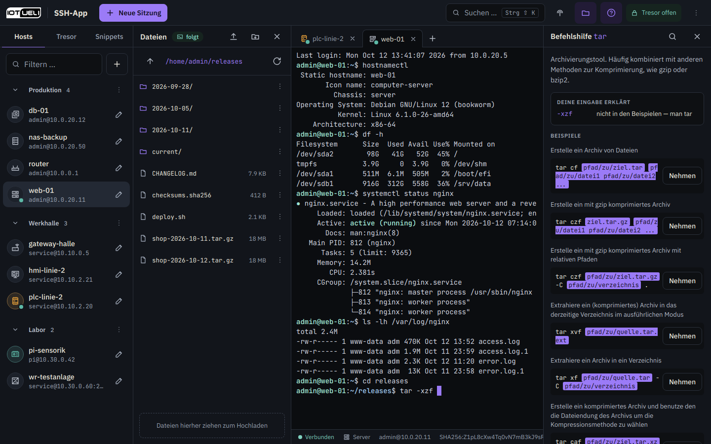
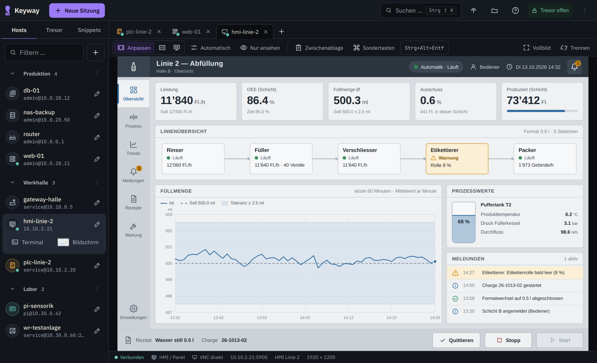
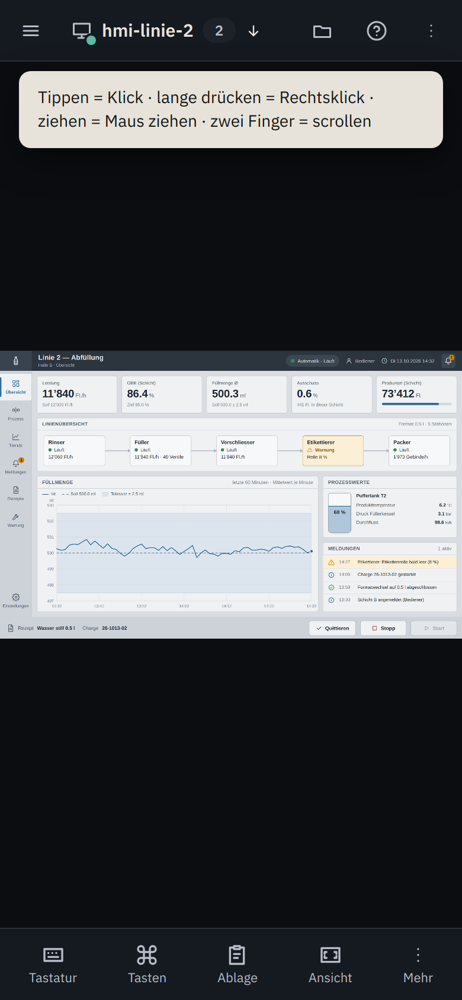
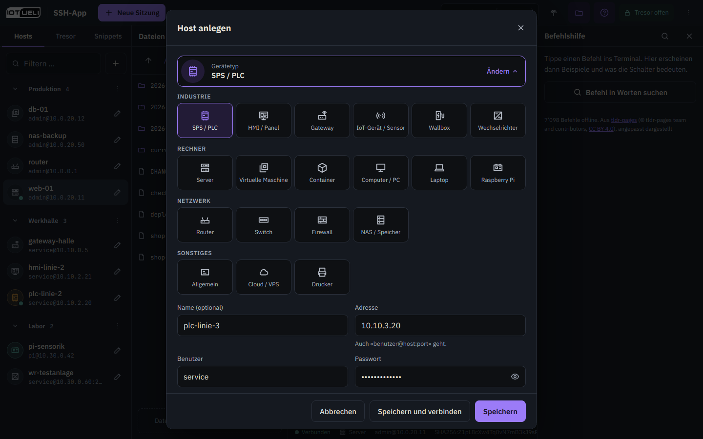
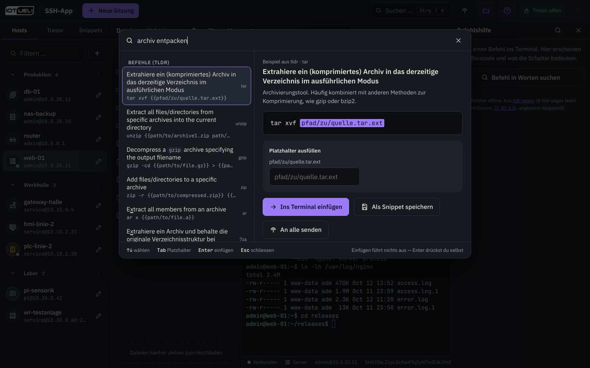
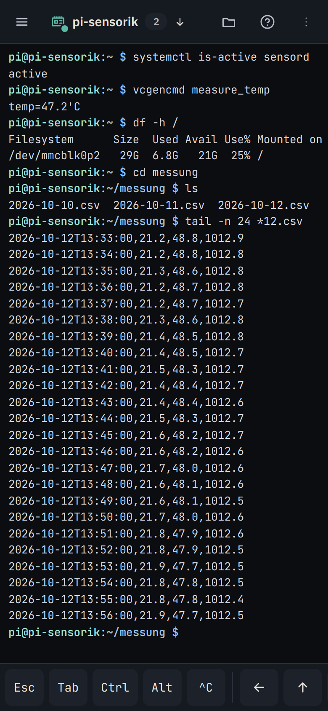
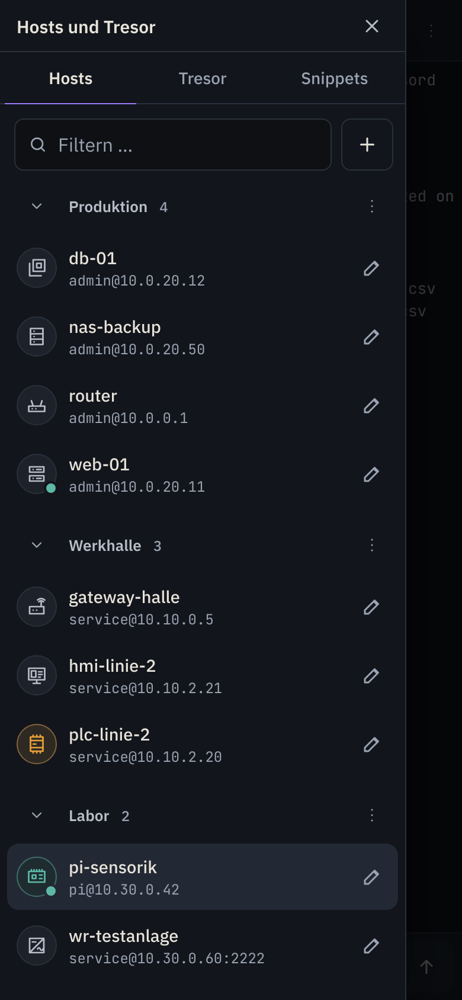
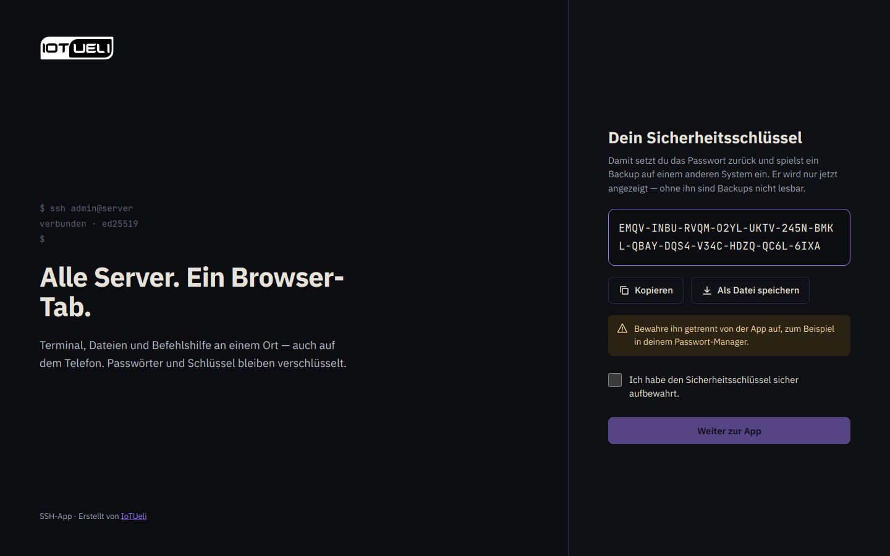

<p align="right"><a href="README.md">English</a> | <a href="README.de.md"><b>Deutsch</b></a></p>

<p align="center">
  
</p>

<h1 align="center">Keyway</h1>

<p align="center">
  by <a href="https://iotueli.ch">IoTUeli</a>
</p>

<p align="center">
  <a href="https://hub.docker.com/r/iotuelich/keyway"></a>
  <a href="https://hub.docker.com/r/iotuelich/keyway"></a>
  <a href="https://github.com/uiff/ssh-app/pkgs/container/keyway"></a>
  
  <a href="https://github.com/uiff/ssh-app/actions/workflows/ci.yml"></a>
  <a href="LICENSE"></a>
</p>

<p align="center">
  Ein selbst gehosteter Web-SSH-Client: Terminal, Bildschirm (VNC), Dateien und Befehlshilfe in einem Browser-Tab, am
  Rechner und auf dem Telefon.
</p>

<p align="center">
  
</p>

Wie MobaXterm, aber im Browser. Keyway läuft als ein einziger Container auf deiner eigenen Hardware, ohne Cloud-Dienst
und ohne Konto bei Dritten. Die Oberfläche gibt es auf Deutsch und Englisch.

> **Zum Namen:** Keyway hiess früher SSH-App. Repository, Programm und Container heissen weiterhin `ssh-app`, die
> Einstellungen beginnen weiterhin mit `SSHAPP_`. Bestehende Installationen, Datenordner und Backups laufen unverändert
> weiter.

## Funktionen

### Terminal

- **Terminal im Browser:** Tabs, 256 Farben, Vollbildprogramme (`top`, `htop`, `vi`), anklickbare Links, Kopieren und
  Einfügen (<kbd>Strg</kbd>+<kbd>Umschalt</kbd>+<kbd>C</kbd> / <kbd>Strg</kbd>+<kbd>Umschalt</kbd>+<kbd>V</kbd>).
- **Sitzungen laufen weiter:** bis zu 12 Stunden auf dem Server, auch ohne offenes Fenster. Nach einem Neuladen oder
  einem Funkloch hängen sie sich von selbst wieder an, mit dem bisherigen Bildschirminhalt. Öffnest du dieselbe Sitzung
  in einem zweiten Fenster, tritt das erste zurück und holt sie mit einem Klick wieder zu sich.
- **Verständliche Fehler:** Klappt eine Verbindung nicht, steht da ein klarer Satz statt eines Netzwerkfehlers, zum
  Beispiel «Verbindung abgelehnt — läuft auf 10.0.0.5:22 ein SSH-Dienst?». Nach rund 20 Sekunden gibt die App auf.
- **Host-Schlüssel:** Beim ersten Verbinden fragt die App nach dem Host-Schlüssel und warnt deutlich, wenn er sich später
  ändert. Die bekannten Host-Schlüssel stehen in den Einstellungen, dort lassen sie sich auch entfernen.
- **An alle senden:** Eingaben gleichzeitig an mehrere Sitzungen schicken.
- **Kritische Hosts:** Bei Hosts mit dem Tag `kritisch` (oder `critical`) fragt die App nach, bevor ein gefährlicher Befehl wie `rm -rf`,
  `dd` oder `reboot` aus einem Snippet, aus der Befehlshilfe oder per «An alle senden» dort ankommt. Beim Tippen mit
  «An alle senden» führt der Tab, in den du tippst, die Zeile wie gewohnt aus. Auf den anderen kritischen Hosts wartet
  eine gefährliche Zeile auf deine Bestätigung, die übrigen Tabs führen sie gleich aus.

### Bildschirm (VNC)

<p align="center">
  
</p>

Wie der RealVNC Viewer, aber im Browser-Tab: den Bildschirm eines Raspberry Pi, eines HMI-Panels oder eines PCs sehen
und bedienen. Jeder Bildschirm öffnet sich als Tab neben den Terminals, auch mehrere gleichzeitig.

- **Je Host einschalten:** im Host-Dialog unter **Erweitert** den **Bildschirm (VNC)** einschalten, die Verbindung
  wählen und den VNC-Port eintragen (meist 5900, Anzeige `:1` = 5901). Die Startseite zeigt diese Hosts dann zuoberst,
  als Karten mit Vorschaubild und den Knöpfen Terminal und Bildschirm. In der Host-Liste bekommen sie dieselben zwei
  Knöpfe. Ein Klick auf die Zeile öffnet das Terminal, bei einem direkt verbundenen HMI-Panel ohne
  SSH-Zugangsdaten den Bildschirm.
- **Über SSH getunnelt (Vorgabe, empfohlen):** Keyway meldet sich per SSH am Host an, genau wie beim Terminal (Prüfung
  des Host-Schlüssels, Benutzername und Passwort, Zugangsdaten speichern), und verbindet sich von dort mit dem
  VNC-Server auf dem Host selbst (`127.0.0.1:<port>`). Der Bildschirm läuft durch die verschlüsselte SSH-Verbindung, im
  Netz muss kein VNC-Port offen sein: Der VNC-Server darf nur auf localhost lauschen. Der SSH-Server muss
  Weiterleitungen erlauben (`AllowTcpForwarding`, bei OpenSSH von Haus aus an), sonst meldet die App das.
- **Direkt:** für Geräte ohne SSH, etwa viele HMI-Panels. Keyway verbindet sich direkt mit `<adresse>:<port>`.
  **Das ist unverschlüsselt:** Zwischen Keyway und dem Gerät gehen Bildschirminhalt und alle Eingaben im Klartext durchs
  Netz, das Passwort schützt nur die schwache VNC-Abfrage (DES). Direkt deshalb nur in einem vertrauenswürdigen Netz
  verwenden. Zwischen Browser und Keyway gilt weiterhin HTTPS.
- **Nur das gespeicherte Ziel:** Keyway verbindet sich nur mit Adresse und Port, die beim Host gespeichert sind. Der
  Browser kann kein anderes Ziel vorgeben.
- **Das VNC-Passwort bleibt auf dem Server:** Du gibst es im Host-Dialog ein oder dann, wenn Keyway danach fragt. Es
  liegt verschlüsselt im Tresor, der Host-Dialog kann es wieder entfernen. Keyway meldet sich selbst am VNC-Server an
  (RFB 3.3, 3.7 und 3.8 mit den Sicherheitstypen None und VNC-Authentication), das Passwort kommt nie in den Browser.
  Fehlt es oder ist es falsch, fragt Keyway nach und speichert es nur nach erfolgreicher Anmeldung und nur mit Haken bei
  «VNC-Passwort für diesen Host speichern». VNC-Authentication verwendet nur die ersten 8 Zeichen. Nach 5 falschen
  Passwörtern beendet Keyway die Verbindung.
- **Andere Anmeldeverfahren reicht Keyway durch:** Bietet der VNC-Server weder None noch VNC-Authentication an (zum
  Beispiel RealVNC Server mit seiner RSA-AES-Anmeldung, Apple Remote Desktop, UltraVNC mit MS-Logon II oder VeNCrypt mit
  Benutzername und Passwort), reicht Keyway die Verbindung unverändert durch, und die Anmeldung läuft im Browser (noVNC).
  Ein dort eingegebenes Passwort speichert Keyway nicht, der Anmeldedialog sagt das. Verfahren, die TLS innerhalb der
  VNC-Verbindung brauchen (VeNCrypt mit TLS oder X.509), gehen im Browser nicht. Bei solchen Geräten den VNC-Server auf
  VNC-Passwort umstellen und die Verschlüsselung dem SSH-Tunnel überlassen.
- **Der Schlüssel des Geräts wird gemerkt:** Weist sich das Gerät mit einem Schlüssel aus (RealVNC Server mit seiner
  RSA-AES-Anmeldung), zeigt Keyway dessen Signatur so, wie RealVNC sie am Gerät anzeigt, dazu einen
  SHA-256-Fingerabdruck. Wie einen SSH-Host-Schlüssel merkt sich Keyway ihn nach deiner Bestätigung, fragt erst wieder,
  wenn er sich ändert (mit deutlicher Warnung), und listet ihn in den Einstellungen unter «Bekannte Host-Schlüssel»,
  wo du ihn auch entfernen kannst.
- **Werkzeugleiste:**
  - **Ansicht und Zoom:** Anpassen (der ganze Bildschirm im Fenster); Zoom mit − und + oder den Stufen 100 %, 150 % und
    200 %, nur in diesem Browser (das Gerät bleibt gleich, das vergrösserte Bild bekommt Rollbalken, Klicks landen
    dort, wo du hinzeigst); oder Fernauflösung (das Gerät stellt seine Auflösung auf das Fenster ein, sofern sein
    VNC-Server das kann; sonst wird das Bild angepasst). Die Fernauflösung ändert den Bildschirm für alle, die ihn
    sehen. Deshalb stellt Keyway das Gerät auf die vorherige Auflösung zurück, wenn du eine andere Ansicht wählst,
    trennst oder den Tab schliesst. Blieb das aus, etwa nach einem Absturz des Browsers, bietet das Menü «Ansicht»
    **Auflösung zurückstellen** an.
  - **Qualität:** Automatisch, Hoch, Mittel oder Niedrig, sichtbar auf dem Knopf («Qualität: Auto»). Niedrige Qualität
    braucht auf langsamen Leitungen weniger Daten.
  - **Nur ansehen:** zuschauen, ohne Maus und Tastatur an das Gerät zu schicken. Es gilt nur für diesen Tab, eine
    Plakette «Nur ansehen» im Bild zeigt es an. Ein Klick oder Tippen auf die Plakette schaltet es aus.
  - **Zwischenablage:** Text in die Zwischenablage des Geräts senden und den zuletzt auf dem Gerät kopierten Text sehen
    und kopieren. Versteht das Gerät nur westeuropäische Zeichen (Latin-1), nennt der Dialog vor dem Senden die
    Zeichen, die dort als «?» ankämen.
  - **Sondertasten:** <kbd>Strg</kbd>+<kbd>Alt</kbd>+<kbd>Entf</kbd>, Windows-Taste, <kbd>Alt</kbd>+<kbd>Tab</kbd>, Esc,
    Tab, Bildschirm drucken und F1 bis F12, die sonst der Browser oder der eigene Rechner abfangen würden.
  - **Vollbild** und **Trennen.** Ein getrennter Bildschirm behält sein letztes Bild abgedunkelt und hat wie ein
    Terminal einen Knopf «Neu verbinden».

  Ansicht, Zoomstufe und Qualität merkt sich dieser Browser je Host. Die Fernauflösung merkt er sich auf Geräten mit
  Touch nie, damit das Öffnen eines Bildschirms nicht ungefragt die Auflösung des Geräts ändert.
  <kbd>Strg</kbd>+<kbd>Umschalt</kbd>+<kbd>K</kbd> öffnet die Suche auch, wenn der Bildschirm die Tastatur hat.
- **Auf dem Telefon:** Tippen klickt, langes Drücken klickt rechts, Ziehen zieht mit der Maus, mit zwei Fingern
  scrollen. Spreizen vergrössert das Bild nur in diesem Browser, der Punkt unter den Fingern bleibt dabei stehen.
  Vergrössert verschiebt ein Finger das Bild (**Verschieben**, von Haus aus an), Tippen klickt weiterhin, und eine
  Zoom-Pille mit − und + zeigt die Stufe. Der Knopf **Tastatur** holt die Bildschirmtastatur, **Tasten** zeigt eine
  Tastenreihe unter dem Bild: Esc, Tab, <kbd>Strg</kbd>, <kbd>Alt</kbd>, <kbd>Umschalt</kbd> und <kbd>Win</kbd> als
  Feststeller für die nächste Taste, das nächste getippte Zeichen oder das nächste Tippen (<kbd>Strg</kbd> und Tippen
  ergibt Strg+Klick), Pfeile, Pos1/Ende, Bild auf/ab, Entf, ein Menü mit F1 bis F12, der Windows-Taste allein,
  <kbd>Alt</kbd>+<kbd>Tab</kbd>, Bildschirm drucken und Einfg sowie <kbd>Strg</kbd>+<kbd>Alt</kbd>+<kbd>Entf</kbd>. Die
  Bildschirmtastatur bleibt dabei offen. Auf dem Tablet zeigt **Sondertasten** in der Werkzeugleiste dieselbe Reihe.
  Quer steht die Werkzeugleiste am rechten Rand.
- **Vorschaubilder:** ein kleines Bild des Bildschirms für Startseite und Host-Liste. Es liegt nur in diesem Browser,
  nie auf dem Server und nicht im Backup. Aktualisiert wird es während der Verbindung alle 30 Sekunden, auch bei «Nur
  ansehen», und beim Trennen. Weil es vertrauliche Inhalte zeigen kann, lässt sich das Speichern in den Einstellungen
  abschalten (Vorgabe an), und die gespeicherten Bilder lassen sich löschen.
- **Ein Bildschirm lebt so lange wie sein Tab:** Anders als Terminal-Sitzungen läuft eine VNC-Verbindung nicht auf dem
  Server weiter. Sie endet, wenn du ihren Tab schliesst, die Seite neu lädst oder dich abmeldest (auch durch die
  automatische Sperre). Danach den Bildschirm wieder öffnen oder im Tab «Neu verbinden» wählen.

<p align="center">
  
</p>

### Hosts mit Gerätetyp

<p align="center">
  
</p>

- **Gerätetypen mit Symbol:** Jeder Host bekommt ein Symbol, zum Beispiel SPS, HMI/Panel, Gateway, IoT-Gerät, Wallbox,
  Wechselrichter, Server, virtuelle Maschine, Container, PC, Laptop, Raspberry Pi, Router, Switch, Firewall, NAS,
  Cloud/VPS oder Drucker. So erkennst du deine Geräte in der Liste auf einen Blick.
- **Einfacher Host-Dialog:** Sichtbar sind nur Gerätetyp, Name, Adresse, Benutzername, Passwort und Ordner. Das Adressfeld
  versteht auch `benutzer@host:port`, `ssh://…`, `ssh -p 2222 benutzer@host` oder `[fe80::1]:2222` und füllt Benutzername und
  Port selbst aus. Port, Schlüssel oder Zugang aus dem Tresor, Bildschirm (VNC), Tags, Farbe, Notiz und «Dateileiste
  folgt dem Terminal» liegen unter **Erweitert**.
- **Ordner, Tags, Farben und Notizen.** Der Filter über der Liste sucht in Namen, Adressen, Benutzernamen, Gerätetypen
  und Tags. Passt genau ein Host, verbindet <kbd>Enter</kbd>.

### Tresor und Zugangsdaten

- **Passwort speichern:** Mit dem Haken «Passwort speichern» im Host-Dialog legt die App das Passwort als verschlüsselten
  Zugang im Tresor ab. Ohne Haken fragt sie beim Verbinden nach Benutzername und Passwort und kann die Zugangsdaten dort nach
  erfolgreicher Anmeldung speichern.
- **Tresor:** Zugänge (Benutzername mit Passwort oder privatem Schlüssel) liegen verschlüsselt (AES-256-GCM, Schlüssel aus dem
  Anmeldepasswort per Argon2id). Schlüssel lassen sich importieren, neu erzeugen (ed25519) und per Knopfdruck auf einem
  Host eintragen (angehängt an `~/.ssh/authorized_keys`). Mehrere Hosts können denselben Zugang nutzen, so änderst du ein
  Passwort nur an einer Stelle.
- **Automatische Sperre:** Nach 30 Minuten ohne Bedienung meldet die App dich ab und sperrt den Tresor. Laufende
  Sitzungen bleiben bestehen und sind nach der Anmeldung wieder da.
- **Sicherheitsschlüssel:** wird bei der Einrichtung einmal angezeigt. Mit ihm setzt du ein vergessenes Passwort zurück
  und spielst Backups ein.

### Dateien

- **SFTP neben dem Terminal:** Hoch- und Herunterladen (auch per Ziehen und Ablegen), Umbenennen, Löschen, Ordner anlegen,
  Pfad kopieren, ins Terminal einfügen oder mit `cd` dorthin wechseln.
- **Sicheres Ersetzen:** Im Normalfall bleibt beim Ersetzen per Hochladen die Datei selbst erhalten (Besitzer, Rechte,
  harte Links, per Docker eingebundene Dateien), und ein abgebrochener Upload lässt das Original unverändert. Die Datei
  kommt dazu erst vollständig in eine Zwischendatei, danach setzt der Host sie ein (die Fortschrittsanzeige zeigt dann
  «Ersetze …», Abbrechen geht nicht mehr). Kennt der SFTP-Dienst des Hosts «copy-data» (OpenSSH ab 9.0), kopiert der
  Host selbst, und die Daten gehen nur einmal über die Leitung. Bei älteren Hosts liest die App die Zwischendatei zurück
  und schreibt sie in die Datei, die Daten gehen dann dreimal über die SSH-Verbindung. Auf das Einsetzen wartet Keyway
  beim Beenden einer Sitzung bis zu einer Minute, beim Herunterfahren bis zu rund 25 Sekunden (deshalb bekommt der
  Container 30 Sekunden zum Stoppen: `stop_grace_period` in der Compose-Datei, `--stop-timeout 30` bei `docker run`).
  Dauert es länger, etwa bei einer grossen Datei auf einem älteren Host über eine langsame Leitung, kann die Datei
  unvollständig bleiben. Die vollständige Fassung liegt dann als versteckte Datei mit der Endung `.sshapp-upload`
  daneben. Zwei Fälle laufen anders. Fehlt im Ordner das Schreibrecht, schreibt die App direkt in die Datei, ein
  Abbruch hinterlässt sie dann unvollständig (die App meldet das). Ist die Datei belegt (etwa ein laufendes Programm),
  ersetzt die App sie durch eine neue Datei: Harte Links und eingebundene Dateien behalten dann den alten Inhalt, und
  der Besitzer kann wechseln. Spezialdateien (Geräte, Pipes, Sockets) lassen sich weder herunterladen noch ersetzen.
- **Folgt dem Terminal:** Auf Linux-Hosts zeigt die Dateileiste nach `cd /var/log` den Ordner `/var/log`, mit bash, zsh,
  fish, tcsh und anderen Shells. Versteht ein Gerät den Startbefehl dafür nicht (Router-CLI, Windows), öffnet die App von
  selbst eine normale Shell. Die Dateileiste folgt dann nur, wenn die Shell ihren Ordner meldet (OSC 7).

### Befehlshilfe und Suche

<p align="center">
  
</p>

- **Befehlshilfe offline:** rund 7000 Befehle aus den [tldr-pages](https://github.com/tldr-pages/tldr), in der Sprache
  der Oberfläche, wo es eine Übersetzung gibt, sonst in der anderen Sprache. Ohne Internetverbindung.
- **Erklärt, was du tippst:** Die Hilfe-Leiste zeigt Beispiele zum Befehl in der aktuellen Zeile und was seine Schalter
  bedeuten. Beispiele haben Platzhalter, die du ausfüllst, bevor sie ins Terminal gehen.
- **Suche in Alltagssprache:** «archiv entpacken» oder «freier speicherplatz» findet die passenden Befehle.
- **Snippets:** eigene Befehle speichern, mit Platzhaltern wie `journalctl -u {{dienst}}`. Beim Einfügen fragt die App
  nach den Werten.
- **Eine Suche für alles:** <kbd>Strg</kbd>+<kbd>Umschalt</kbd>+<kbd>K</kbd> durchsucht Hosts, Snippets und Befehle, von
  überall aus (am Mac <kbd>Cmd</kbd>+<kbd>K</kbd>). <kbd>Strg</kbd>+<kbd>K</kbd> allein geht nur ausserhalb des Terminals,
  denn dort gehört die Taste der Shell (nano, bash).

### Auf dem Telefon

<table>
  <tr>
    <td align="center"></td>
    <td align="center"></td>
  </tr>
</table>

- **Tastenleiste** mit Esc, Tab, Strg, Alt, Pfeilen, Pos1/Ende, Bild auf/ab, <kbd>Strg</kbd>+<kbd>C</kbd>/<kbd>D</kbd>/<kbd>Z</kbd>/<kbd>R</kbd>,
  den häufigsten Sonderzeichen der Shell sowie Einfügen und Kopieren.
- **Für die Finger gemacht:** Menü, Dateien und Hilfe öffnen als Blätter, jede Trefferfläche ist mindestens 44 px gross.
- **Bildschirm mit den Fingern:** Gesten zum Klicken, Rechtsklicken, Ziehen, Scrollen und Vergrössern, die
  Bildschirmtastatur und eine Tastenreihe mit Strg, Alt, Umschalt, Win und F1 bis F12 (siehe
  [Bildschirm (VNC)](#bildschirm-vnc)).
- **Startbildschirm:** Auf dem Startbildschirm abgelegt, läuft Keyway wie eine eigene App.

### Sprache und Aussehen

- **Deutsch und Englisch:** Die Oberfläche folgt der Sprache des Browsers. Umstellen kannst du sie auf der Anmeldeseite,
  im Menü oder unter Einstellungen › Darstellung. Die Seite lädt dann neu, laufende Terminals verbinden sich von selbst wieder.
  Offene Bildschirme (VNC) werden dabei getrennt, deshalb fragt die App vorher nach.
  Auch Meldungen des Servers, etwa zu Verbindungsfehlern, kommen in dieser Sprache.
- **Akzentfarbe:** Vorgabe Violett, umstellbar auf Blau, Türkis, Grün, Bernstein oder Rosa. Die Wahl gilt für den
  jeweiligen Browser. Warnungen behalten ihre eigenen Farben.
- **Schriftgrösse im Terminal**, ebenfalls je Browser.

### Backup

- **Eine verschlüsselte Datei** mit allen Hosts (samt VNC-Einstellungen und gespeicherten VNC-Passwörtern), Ordnern,
  Zugängen, Snippets und bekannten Host-Schlüsseln. Mit dem
  Sicherheitsschlüssel lässt sie sich auf diesem oder einem anderen System wieder einspielen. Dabei kommt auch die
  Anmeldung des gesicherten Systems zurück (siehe [Backup und Umzug](#backup-und-umzug)).

## Schnellstart

Fertige Images für `linux/amd64` und `linux/arm64` (z. B. Raspberry Pi oder Industrie-Controller) gibt es auf
[Docker Hub](https://hub.docker.com/r/iotuelich/keyway) und in der
[GitHub Container Registry](https://github.com/uiff/ssh-app/pkgs/container/keyway). Docker wählt die passende Plattform
selbst.

**Mit Docker Compose** (empfohlen, die Compose-Datei härtet den Container zusätzlich):

```bash
mkdir keyway && cd keyway
curl -fsSLO https://raw.githubusercontent.com/uiff/ssh-app/main/compose.yml
docker compose up -d
```

**Oder mit einem einzigen Befehl:**

```bash
docker run -d --name ssh-app -p 8443:8443 -v ssh-app-daten:/data --restart unless-stopped --stop-timeout 30 \
  iotuelich/keyway:latest
```

Danach im Browser `https://<adresse-des-rechners>:8443` öffnen und **sofort einrichten** (siehe unten). Die App erzeugt
beim ersten Start ein eigenes Zertifikat. Der Browser warnt deshalb einmal, das ist erwartet. Den Fingerabdruck zum
Vergleichen zeigt `docker logs ssh-app` in der Zeile «HTTPS mit eigenem Zertifikat, Fingerabdruck SHA-256 …».

Das Zertifikat lautet auf «Keyway (self-signed)». Installationen von vor der Umbenennung behalten ihr Zertifikat mit dem
alten Namen `ssh-app` und damit auch ihren Fingerabdruck. Wer den neuen Namen will, stoppt den Container, löscht im
Daten-Volume den Ordner `tls` (zum Beispiel mit `docker run --rm --volumes-from ssh-app alpine rm -rf /data/tls`) und
startet ihn wieder. Danach ändert sich der Fingerabdruck, und der Browser warnt noch einmal.

Die Compose-Datei härtet den Container zusätzlich (nur lesbares Dateisystem, keine Linux-Capabilities). Wer `docker run`
nimmt, kann das mit `--read-only --tmpfs /tmp --cap-drop ALL --security-opt no-new-privileges:true` nachbilden.

Statt des Volumes geht auch ein Ordner des Rechners (`-v /pfad/zu/daten:/data`). Er muss dem Benutzer gehören, als der die
App im Container läuft: `sudo chown 65532:65532 /pfad/zu/daten`. Sonst bricht der Start mit einem Hinweis im Log ab.

### Images und Tags

| Image | Wo |
|---|---|
| `iotuelich/keyway` | [Docker Hub](https://hub.docker.com/r/iotuelich/keyway) |
| `ghcr.io/uiff/keyway` | [GitHub Container Registry](https://github.com/uiff/ssh-app/pkgs/container/keyway), dieselben Images |

| Tag | Bedeutung |
|---|---|
| `latest` | die neueste Version |
| `0.3.0` | genau diese Version |
| `0.3` | die neueste Version von 0.3.x (nur Fehlerbehebungen) |

Jedes Image baut [GitHub Actions](https://github.com/uiff/ssh-app/actions/workflows/container.yml) aus diesem
Repository. Es wird vor dem Veröffentlichen getestet und einmal gestartet und trägt einen Herkunftsnachweis
(Provenance) und eine Stückliste (SBOM).

### Version und Aktualisieren

Welche Version läuft, steht unter Einstellungen › Über. Zum Aktualisieren zuerst ein Backup herunterladen
(Einstellungen › Backup), dann:

```bash
docker compose pull
docker compose up -d
```

Ohne Compose: `docker pull iotuelich/keyway:latest`, dann `docker stop ssh-app && docker rm ssh-app` und den Container
mit demselben `docker run`-Befehl wieder starten. Hosts, Zugänge und die Anmeldung bleiben im Volume erhalten. Wer bei
einer Versionslinie bleiben will, nimmt statt `latest` einen Tag wie `iotuelich/keyway:0.3`.

### Selbst bauen

Wer das Image selbst bauen will, zum Beispiel um eine Änderung auszuprobieren:

```bash
git clone https://github.com/uiff/ssh-app.git
cd ssh-app
```

In `compose.yml` die Zeile `image: iotuelich/keyway:latest` durch die beiden auskommentierten Zeilen `build: .` und
`image: ssh-app:latest` ersetzen, dann `docker compose up -d --build`. Aktualisieren: `git pull` und derselbe Befehl.

Ohne Compose:

```bash
docker build -t ssh-app https://github.com/uiff/ssh-app.git
docker run -d --name ssh-app -p 8443:8443 -v ssh-app-daten:/data --restart unless-stopped --stop-timeout 30 ssh-app
```

`git clone` und `docker build` mit der Adresse des Repositorys bauen beide den aktuellen Stand des Standard-Branches.

Das Programm wird per Cross-Compile übersetzt, für eine andere Plattform braucht es keinen Emulator (QEMU):

- **Auf dem Gerät selbst:** wie oben bauen, die Plattform ergibt sich von selbst.
- **Auf einem anderen Rechner für ein Gerät** (eine Plattform, klappt mit dem Standard-Builder):

  ```bash
  docker buildx build --platform linux/arm64 -t ssh-app --load .
  docker save ssh-app | gzip > ssh-app-arm64.tar.gz
  ```

  Die Datei aufs Gerät kopieren, dort `docker load -i ssh-app-arm64.tar.gz` und den Container mit `docker run` wie oben
  starten (Image `ssh-app`). Mit der Compose-Datei die Bau-Zeilen von oben nehmen und `docker compose up -d` ohne
  `--build` aufrufen, dann nimmt sie das geladene Image `ssh-app:latest`.
- **Mehrere Plattformen in einem Image:** Das braucht einen buildx-Builder mit dem Treiber `docker-container`. Der
  Standard-Builder (Treiber `docker`) lehnt mehrere Plattformen ab, ausser der containerd-Image-Speicher ist eingeschaltet.
  Ein Image für mehrere Plattformen lässt sich ausserdem nicht in den lokalen Image-Speicher laden, es gehört in eine Registry:

  ```bash
  docker buildx create --name ssh-app-bau --driver docker-container --use   # einmalig
  docker buildx build --platform linux/amd64,linux/arm64 -t <registry>/ssh-app:<version> --push .
  ```

  Ohne `--push` (oder `--output`) bleibt das Ergebnis nur im Build-Cache liegen.

## Ersteinrichtung

<p align="center">
  
</p>

**Gleich nach dem ersten Start erledigen.** Solange die App nicht eingerichtet ist, kann jeder, der ihre Adresse erreicht,
das Konto anlegen oder ein Backup einspielen: Wer zuerst kommt, richtet ein. Den Port deshalb erst freigeben, wenn die
Einrichtung erledigt ist.

1. Benutzername und Passwort festlegen (mindestens 10 Zeichen). Das Passwort entsperrt auch den Tresor.
2. Die App zeigt **einmal** den **Sicherheitsschlüssel** an. Kopieren oder als Datei speichern und getrennt von der App
   aufbewahren, zum Beispiel im Passwort-Manager. Mit ihm kannst du
   - das Passwort zurücksetzen («Passwort vergessen?» auf der Anmeldeseite),
   - ein Backup einspielen, auch auf einem anderen System.

   Ohne Sicherheitsschlüssel ist ein Backup nicht lesbar.
3. Hosts anlegen: Gerätetyp wählen, Adresse und Benutzername eintragen, Passwort eingeben oder beim Verbinden fragen lassen.

## Backup und Umzug

- **Backup herunterladen:** Einstellungen › Backup. Du bekommst eine verschlüsselte Datei, Passwörter und Schlüssel darin
  bleiben verschlüsselt.
- **Umzug auf ein neues System:** dort beim ersten Start «Backup einspielen» wählen, Backup-Datei und
  Sicherheitsschlüssel angeben. Danach meldest du dich mit Benutzername und Passwort des alten Systems an. Der
  Sicherheitsschlüssel des alten Systems bleibt gültig.
- **Auf einem laufenden System einspielen:** Einstellungen › Backup › **Backup einspielen** ersetzt alle Hosts, Ordner,
  Zugänge, Snippets und bekannten Host-Schlüssel auf diesem System **und auch die Anmeldung**. Dabei werden alle abgemeldet.
  Danach meldest du dich mit Benutzername und Passwort des gesicherten Systems an, gültig ist dann nur dessen
  Sicherheitsschlüssel. Benutzername, Passwort und Sicherheitsschlüssel, die dieses System vorher hatte, gelten nicht mehr.
- **Passwort ändern:** Der Sicherheitsschlüssel bleibt dabei gültig.

## Einstellungen (Umgebungsvariablen)

Das Image setzt einige Variablen selbst (Spalte «Container»). Wer das Programm ohne Container startet, etwa mit
`go run`, bekommt die Vorgaben des Programms (Spalte «ohne Container»).

| Variable | Container | ohne Container | Bedeutung |
|---|---|---|---|
| `SSHAPP_ADDR` | `:8443` | `:8443` | Adresse und Port. Im Container immer in der Form `:<port>`, die eingebaute Gesundheitsprüfung fragt `127.0.0.1:<port>` ab |
| `SSHAPP_DATA` | `/data` | `./data` | Datenordner (Datenbank, Zertifikat) |
| `SSHAPP_HILFE` | `/app/hilfe` | `<SSHAPP_DATA>/hilfe` | Ordner mit `tldr-pages.de.zip` und `tldr-pages.en.zip` (Befehlshilfe) |
| `SSHAPP_TLS` | `auto` | `auto` | `auto` = selbst erzeugtes Zertifikat, `aus` = nur HTTP (nur hinter einem Reverse-Proxy), `eigen` = eigenes Zertifikat aus `SSHAPP_TLS_CERT` und `SSHAPP_TLS_KEY` |
| `SSHAPP_TLS_CERT` | – | – | Bei `SSHAPP_TLS=eigen`: Pfad zum Zertifikat (PEM, mit Zwischenzertifikaten) |
| `SSHAPP_TLS_KEY` | – | – | Bei `SSHAPP_TLS=eigen`: Pfad zum privaten Schlüssel (PEM). Im Container muss er für den Benutzer 65532 lesbar sein |
| `SSHAPP_COOKIE_SECURE` | – | – | `1` = Cookie nur über HTTPS (bei `SSHAPP_TLS=aus` hinter einem HTTPS-Proxy setzen) |
| `SSHAPP_PROXY` | – | – | Adressen oder Netze vertrauenswürdiger Reverse-Proxys, durch Komma getrennt (z. B. `172.16.0.0/12` oder `10.0.0.5, fd00::/8`). Nur bei Anfragen von dort gelten `X-Forwarded-For` (Anmeldesperre je Browser statt je Proxy) und `X-Forwarded-Host` (WebSockets für Terminal und VNC) |
| `SSHAPP_HOSTS` | – | – | Zusätzlich erlaubte Namen der App, durch Komma getrennt, `*.firma.ch` für alle Unternamen (Schutz vor DNS-Rebinding, siehe unten). Ist die Variable gesetzt, prüft die App den Namen immer, auch mit HTTPS |
| `SSHAPP_ORIGINS` | – | – | Zusätzlich erlaubte Herkunft (`Origin`) für die WebSockets von Terminal und VNC, durch Komma getrennt, Muster wie `https://*.firma.ch`. Nur nötig, wenn ein Proxy den Host-Kopf verändert |
| `SSHAPP_HSTS` | – | – | `1` = Strict-Transport-Security senden: Browser rufen den Namen dann ein Jahr lang nur noch per HTTPS auf, auf allen Ports. Nur setzen, wenn alles unter diesem Namen HTTPS spricht |
| `SSHAPP_LEERLAUF_MIN` | `30` | `30` | Minuten ohne Bedienung, bis die Anmeldung abläuft und der Tresor sich sperrt. Bedienung heisst Tippen im Terminal, Eingaben auf einem VNC-Bildschirm (Zuschauen zählt nicht, auch nicht mit «Nur ansehen») und Aktionen in der App; automatische Abfragen im Hintergrund zählen nicht. Laufende Terminal-Sitzungen bleiben bestehen und lassen sich nach der Anmeldung wieder öffnen, VNC-Bildschirme werden getrennt |

**Schutz vor DNS-Rebinding:** Eine fremde Webseite könnte ihren eigenen Namen auf die Adresse der App zeigen lassen. Deshalb
prüft die App im HTTP-Betrieb (`SSHAPP_TLS=aus`) und immer, sobald `SSHAPP_HOSTS` gesetzt ist, unter welchem Namen sie
aufgerufen wird. Ausgenommen ist nur der Betrieb hinter einem HTTPS-Proxy (`SSHAPP_COOKIE_SECURE=1`) ohne `SSHAPP_PROXY`
und ohne `SSHAPP_HOSTS`, denn dann kennt die App den Namen nicht. Ohne Eintrag erlaubt sind IP-Adressen, `localhost`,
Rechnernamen ohne Punkt und die lokalen Endungen `.local`, `.lan`, `.home`, `.home.arpa`, `.internal`, `.intranet`,
`.localdomain`, `.localhost`, `.fritz.box` und `.ts.net` (Tailscale). Andere Namen (etwa `ssh.firma.ch`) gehören in
`SSHAPP_HOSTS`. Anfragen von einem Proxy aus `SSHAPP_PROXY` prüft die App nicht, das übernimmt der Proxy.

## Betrieb hinter einem Reverse-Proxy

Mit einem Proxy (Caddy, nginx, Traefik) und einem Zertifikat, dem der Browser vertraut, entfällt die Zertifikatswarnung. Die App spricht
dann nur HTTP und ist nur für den Proxy erreichbar. In `compose.yml`:

```yaml
    ports:
      - "127.0.0.1:8080:8080"     # nur für den Proxy auf demselben Rechner
    environment:
      SSHAPP_ADDR: ":8080"
      SSHAPP_TLS: "aus"
      SSHAPP_COOKIE_SECURE: "1"   # Cookie nur über HTTPS
      SSHAPP_PROXY: "172.16.0.0/12"  # so sieht die App einen Proxy auf dem Rechner (Docker-Netze)
```

Unter welcher Adresse die App den Proxy sieht, steht nach einem Anmeldeversuch im Log (`docker logs ssh-app`, Zeile
«Anmeldung von …»; das Log ist deutsch). Läuft der
Proxy auf demselben Rechner, ist das die Gateway-Adresse des Docker-Netzes, meist aus `172.16.0.0/12`. Liegt das eigene
Netz selbst in diesem Bereich, besser nur die genaue Adresse eintragen.

Was der Proxy können muss:

- **WebSockets** weiterreichen (Terminal unter `/api/ws`, VNC-Bildschirm unter `/api/vnc`). Terminal und Bildschirm
  schicken alle 25 Sekunden ein Lebenszeichen, ihnen reichen die üblichen Zeitlimits von 60 Sekunden (nginx:
  `proxy_read_timeout`), auch einem Bildschirm, dessen Bild sich nicht ändert.
- **Den Host-Kopf unverändert weitergeben, samt Port** (oder `X-Forwarded-Host` setzen; das gilt nur, wenn der Proxy in
  `SSHAPP_PROXY` steht). Die App lässt einen WebSocket nur zu, wenn `Origin` und `Host` übereinstimmen. Sonst öffnet sich
  die Seite, aber kein Terminal und kein Bildschirm.
- **`X-Forwarded-For`** setzen, damit die Anmeldesperre den einzelnen Browser trifft und nicht alle.
- **Grosse Uploads** zulassen. Die Dateileiste lädt Dateien beliebiger Grösse hoch, ein Backup darf bis 64 MB gross sein.

Caddy erfüllt das von sich aus. Für eine eigene Domain holt Caddy das Zertifikat selbst bei Let’s Encrypt:

```
ssh.example.com {
    reverse_proxy 127.0.0.1:8080
}
```

Dafür muss der Name im öffentlichen DNS auf diesen Rechner zeigen, und Port 80 oder 443 muss aus dem Internet
erreichbar sein. Soll die App im eigenen Netz bleiben, geht es stattdessen über die DNS-Challenge (ein Caddy-Build mit
dem Modul für deinen DNS-Anbieter, siehe Caddy-Dokumentation).

Für einen Namen, den es nur im eigenen Netz gibt (etwa `ssh.home.lan` oder `ssh.local`), stellt keine öffentliche
Zertifizierungsstelle ein Zertifikat aus. Mit `tls internal` unterschreibt Caddy es selbst:

```
ssh.home.lan {
    tls internal
    reverse_proxy 127.0.0.1:8080
}
```

Browser vertrauen diesem Zertifikat erst, wenn das Stammzertifikat von Caddy auf jedem Gerät installiert ist. Es liegt
im Datenordner von Caddy unter `pki/authorities/local/root.crt`; auf dem Caddy-Rechner selbst installiert es
`caddy trust`. Gibt es für den Namen schon ein Zertifikat, steht statt `tls internal` die Zeile
`tls /pfad/zu/cert.pem /pfad/zu/key.pem`.

nginx braucht ein paar Zeilen mehr:

```nginx
map $http_upgrade $connection_upgrade {
    default upgrade;
    ''      close;
}

server {
    listen 443 ssl;
    server_name ssh.example.com;
    # ssl_certificate und ssl_certificate_key wie üblich

    location / {
        proxy_pass http://127.0.0.1:8080;
        proxy_http_version 1.1;
        proxy_set_header Host $http_host;
        proxy_set_header X-Forwarded-For $proxy_add_x_forwarded_for;
        proxy_set_header Upgrade $http_upgrade;
        proxy_set_header Connection $connection_upgrade;
        client_max_body_size 0;
    }
}
```

Die App zählt Fehlversuche bei der Anmeldung je Absender-Adresse. Hinter einem Proxy sieht sie nur dessen Adresse,
ausser er steht in `SSHAPP_PROXY`: Dann nimmt sie die Adresse des Browsers aus `X-Forwarded-For`. Ohne `SSHAPP_PROXY` ist
die Anmeldung nach 5 Fehlversuchen 15 Minuten lang für alle gesperrt, nicht nur für den Absender. Darauf weist die App
beim Start im Log hin.

## Sicherheit

- Anmeldung mit Sperre: nach 5 Fehlversuchen von einer Adresse 15 Minuten lang. IPv6-Adressen aus fremden Netzen zählen
  zusätzlich gemeinsam je /64-Netz (Grenze 30), denn ein Anschluss hat dort viele Adressen. Laufende Versuche zählen mit,
  paralleles Raten stösst also an dieselbe Grenze, und bei Überlast bittet die Anmeldung kurz um Geduld. Dazu Cookies
  `HttpOnly` und `SameSite=Strict`, eigener Kopf gegen CSRF, strenge Content-Security-Policy, Schutz vor DNS-Rebinding im
  HTTP-Betrieb.
- Passwörter und private Schlüssel liegen nur verschlüsselt in der Datenbank. Der Schlüssel dazu liegt nur im Arbeitsspeicher
  und wird beim Sperren verworfen (Abmelden oder Leerlauf). Kopien, die Go selbst anlegt (etwa das eingegebene Passwort oder
  interne Puffer), lassen sich nicht garantiert löschen. Wer den Speicher des Prozesses lesen kann (root, Core-Dump, Swap),
  findet sie unter Umständen. Für den Verbindungsaufbau muss der Server ein Geheimnis kurz entschlüsseln. Eine
  Ende-zu-Ende-Verschlüsselung bis in den Browser ist für ein SSH-Gateway nicht möglich.
- VNC: Über SSH läuft der Bildschirm durch die verschlüsselte SSH-Verbindung. Mit «Direkt» ist die VNC-Verbindung
  zwischen Keyway und dem Gerät unverschlüsselt, deshalb nur in einem vertrauenswürdigen Netz verwenden. Das VNC-Passwort
  bleibt auf dem Server: Keyway meldet sich selbst am VNC-Server an, der Browser bekommt nur das Bild. Keyway verbindet
  sich nur mit Adresse und Port, die beim Host gespeichert sind. Läuft die Anmeldung durchgereicht im Browser und weist
  sich das Gerät mit einem Schlüssel aus (RealVNC RSA-AES), merkt sich Keyway ihn wie einen SSH-Host-Schlüssel und
  warnt, wenn er sich ändert.
- Das Image enthält keine Shell und läuft als unprivilegierter Benutzer (65532). Die Compose-Datei setzt zusätzlich ein nur
  lesbares Dateisystem und entzieht alle Linux-Capabilities.
- Die Ersteinrichtung ist offen, bis jemand sie erledigt. Deshalb gleich nach dem Start einrichten (siehe oben).
- Die App ist für das eigene Netz gedacht. Nicht ungeschützt ins Internet stellen.

## Entwicklung

```bash
go test ./...          # Tests inkl. Ende-zu-Ende mit eingebettetem SSH-Server
go run ./cmd/ssh-app   # startet auf https://localhost:8443, Daten in ./data
node --experimental-websocket tools/klicktest.js <url> <ssh-host> <port> <benutzer> <passwort> <fotoordner> [breite hoehe]
```

`tools/klicktest.js` klickt sich per Headless-Chrome durch die Oberfläche und macht dabei Fotos. Mit `-` als
`<ssh-host>` prüft es die Oberfläche ohne SSH-Ziel. `SPRACHE=de|en` wählt die Sprache der Oberfläche,
`CDP_PORT=<port>` einen festen Port für die Fernsteuerung von Chrome (sonst ein zufälliger).

Was der Klicktest braucht:

- **Node.js ab 20.10** (wegen `--experimental-websocket`) und **Chrome Headless Shell** im Puppeteer-Cache
  (`npx @puppeteer/browsers install chrome-headless-shell@stable --path ~/.cache/puppeteer`), oder ein anderes Chrome
  mit `CHROME=/pfad/zu/chrome`.
- **Eine Instanz, die noch nicht eingerichtet ist.** Der Test richtet sie dann selbst ein (Benutzername `admin`,
  Passwort `klicktest-passwort`). Bei einer schon eingerichteten Instanz deren Benutzername und Passwort als
  `SSHAPP_USER` und `SSHAPP_PW` mitgeben.
- **Einen Datenordner zum Wegwerfen.** Der Test legt einen Zugang und einen Host an. Die Instanz deshalb mit eigenem
  Datenordner starten, zum Beispiel `SSHAPP_DATA=/tmp/klick go run ./cmd/ssh-app`, und nicht mit dem gewohnten `./data`.

Für Terminal und Dateileiste braucht es kein echtes Gerät: Die Tests bringen einen eigenen **Test-SSH-Server** mit.
`SSHAPP_TESTSSH_HALTEN=600 go test ./internal/server -run 'TestSSHHalten$' -v -timeout 0` hält ihn 600 Sekunden lang offen und
nennt seine Adresse (`TESTSSH 127.0.0.1:<port>`). Benutzername ist `pi`, Passwort `himbeere`. Seine Shell gibt nur das
Getippte zurück, sein SFTP zeigt das lokale Dateisystem deines Rechners. Zum Beispiel:

```bash
node --experimental-websocket tools/klicktest.js https://localhost:8443 127.0.0.1 <port> pi himbeere ./fotos
```

`DATEIEN_ORDNER=<ordner>` prüft zusätzlich die Dateileiste. Das geht nur mit dem Test-SSH-Server, denn der Ordner wird
auf deinem Rechner angelegt.

Für den Bildschirm gibt es ausserdem einen **Test-VNC-Server**. Er lauscht nur auf dem eigenen Rechner (`127.0.0.1`
oder `::1`) und zeigt ein Testbild mit laufender Uhr. Klicks malen Punkte, Tasten, Mausrad und Zwischenablage erscheinen
im Bild.

```bash
go run ./tools/testvnc -addr 127.0.0.1:5999 -passwort geheim
```

In Keyway dazu einen Host mit der Adresse `127.0.0.1` anlegen, VNC mit Port 5999 einschalten und «Direkt» wählen. Für
den SSH-Tunnel stattdessen den Test-SSH-Server als Host nehmen (Verbindung «Über SSH getunnelt», VNC-Port 5999): Seine
Weiterleitung landet auf deinem Rechner. `-typ vencrypt` prüft das Durchreichen (Anmeldung im Browser), `-version 3.3`
einen alten Server und `-bild <datei.png>` zeigt ein eigenes Bild. Läuft der Test-VNC-Server, prüft
`tools/klicktest.js` mit `VNC_PORT=5999 VNC_PW=geheim` auch den Bildschirm-Tab (Passwort-Rückfrage, Klicks,
Werkzeugleiste, Zoom mit Klicks an der richtigen Stelle, Plakette «Nur ansehen», Telefon-Tastatur und Tastenreihe,
Vorschaubild).

Der Bildschirm-Viewer (noVNC) schreibt nur auf Wunsch in die Browser-Konsole: im `localStorage` den Schlüssel
`sshapp.vncProtokoll` auf `"debug"`, `"info"`, `"warn"` oder `"error"` setzen und die Seite neu laden.

Für die Befehlshilfe in der Entwicklung `tldr-pages.de.zip` und `tldr-pages.en.zip` von
<https://github.com/tldr-pages/tldr/releases> nach `./data/hilfe/` legen (bzw. nach `<SSHAPP_DATA>/hilfe/`).
Das Image packt die Archive beim Bau selbst, aus einem festen Stand des tldr-Repositorys (`TLDR_COMMIT` im Dockerfile).

Aufbau: Go-Backend (`internal/`), eingebettete Oberfläche ohne Build-Schritt (`web/static/`), SQLite als Speicher.
Technische Namen (Go-Modul `github.com/uiff/ssh-app`, Programm `cmd/ssh-app`, Variablen `SSHAPP_*`, Köpfe `X-SSH-App*`,
Backup-Format) tragen weiterhin den alten Namen `ssh-app`, damit bestehende Installationen und Backups passen.

Übersetzungen: Jeder Text liegt auf Deutsch und Englisch vor.

- Browser: Kataloge in `web/static/js/sprache/<bereich>.js` (`i18nErgaenzen({ de: {…}, en: {…} })`). Im Code steht
  `t('bereich.schluessel', { name })`.
- Server: Kataloge in `internal/texte/<bereich>.go` (`texte.Eintragen(de, en)`), Aufruf mit `texte.T(sprache, schluessel, …)`.
  `internal/texte/texte_test.go` prüft, dass jeder Schlüssel beide Sprachen mit denselben Platzhaltern hat.
- Der Browser schickt seine Sprache bei jeder Anfrage mit (Kopf `X-SSH-App-Sprache`, beim WebSocket und bei Downloads
  der Parameter `sprache`).
- Wächter-Tests: `web/sprache_test.go` (jeder im Browser-Code benutzte Schlüssel steht in beiden Sprachen, keiner ist
  ungenutzt, kein deutscher Text ausserhalb der Kataloge, keine Emoji) und `internal/server/rohtext_test.go` (keine
  Text-Literale in HTTP- und WebSocket-Antworten, jeder im Go-Code benutzte Schlüssel existiert mit passenden Platzhaltern).

### Neue Version veröffentlichen

Ein Versions-Tag baut und veröffentlicht die Images (`.github/workflows/container.yml`): Tests, ein Probestart des
Images, dann der Bau für `linux/amd64` und `linux/arm64` und das Hochladen nach ghcr.io und Docker Hub. Die Beschreibung
auf Docker Hub kommt aus [`DOCKERHUB.md`](DOCKERHUB.md).

```bash
git tag v0.3.1
git push origin v0.3.1
```

Für Docker Hub braucht es zwei Repository-Secrets (Settings › Secrets and variables › Actions): `DOCKERHUB_USERNAME` und
`DOCKERHUB_TOKEN`, ein Docker-Hub-Zugriffstoken (Personal Access Token) mit «Read, Write, Delete» (nötig für die
Beschreibung). Ohne sie gehen die Images nur nach ghcr.io. Von Hand auf `main` gestartet, veröffentlicht der Workflow den
Tag `edge`.

## Lizenz

MIT, siehe [LICENSE](LICENSE). Drittsoftware und Daten: siehe [NOTICE](NOTICE). Die Lizenztexte aller mitgelieferten und
ins Programm übersetzten Bibliotheken sind eingebettet und in der App unter Einstellungen › Über › Lizenzen abrufbar.
Die Befehlshilfe stammt aus den [tldr-pages](https://github.com/tldr-pages/tldr) (CC BY 4.0). Der Bildschirm nutzt
[noVNC](https://github.com/novnc/noVNC) (MPL-2.0), unverändert mitgeliefert in `web/static/vendor/novnc/`. Namen und Logos «Keyway»
und «IoTUeli» sind Kennzeichen von IoTUeli und nicht Teil der MIT-Lizenz.
