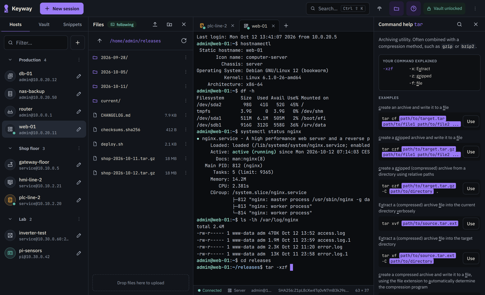
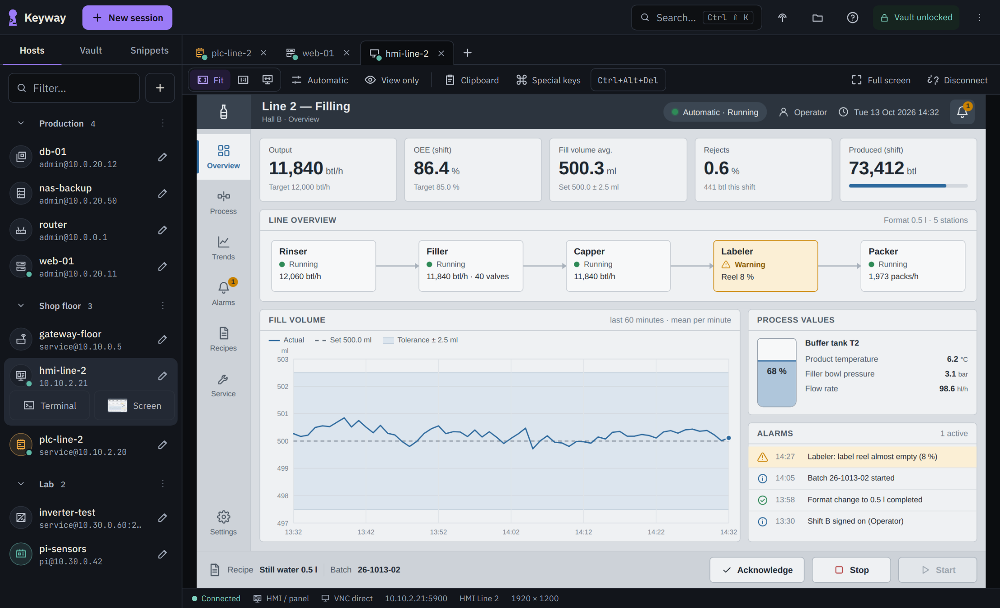
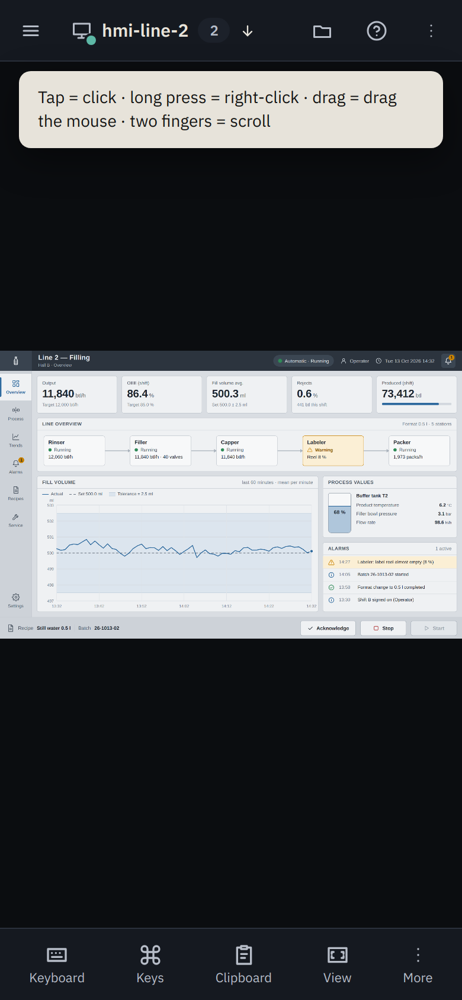
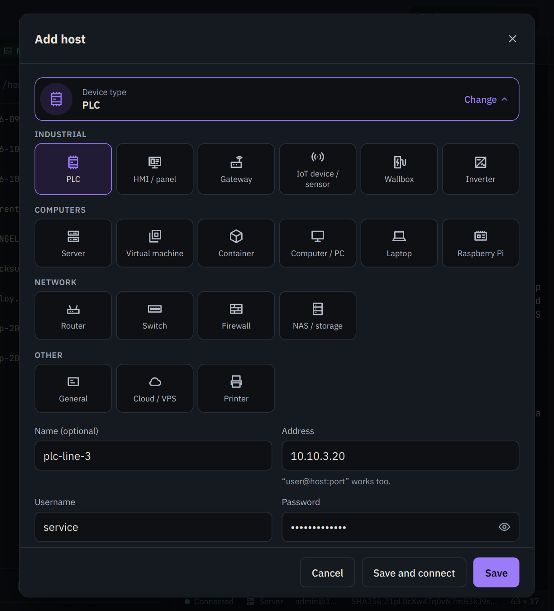
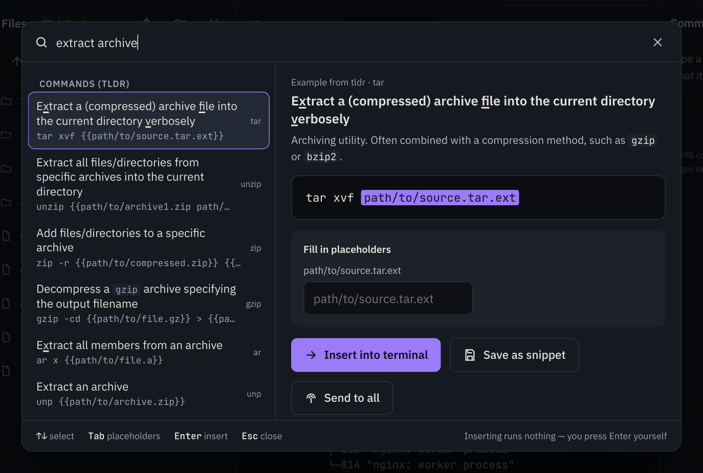
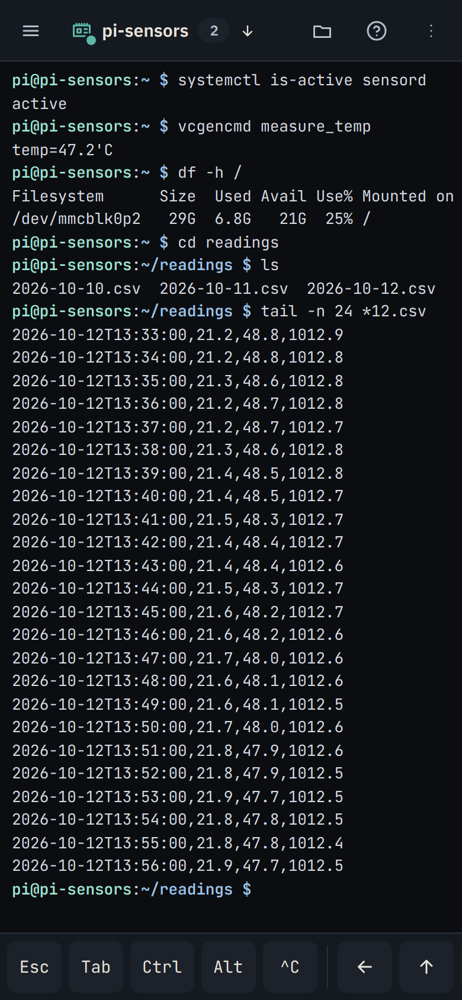
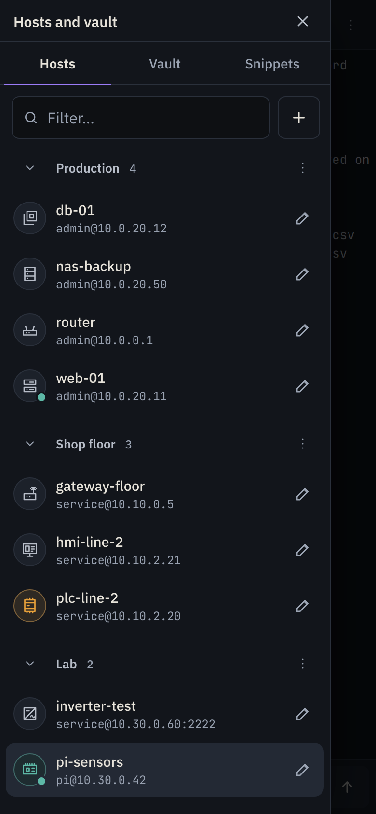
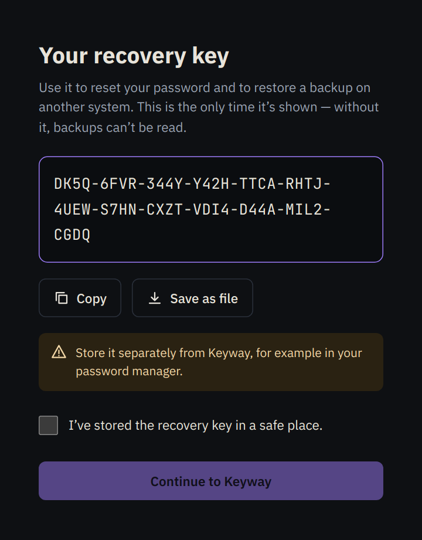

<p align="right"><a href="README.md"><b>English</b></a> | <a href="README.de.md">Deutsch</a></p>

<p align="center">
  
</p>

<h1 align="center">Keyway</h1>

<p align="center">
  by <a href="https://iotueli.ch">IoTUeli</a>
</p>

<p align="center">
  <a href="https://hub.docker.com/r/iotuelich/keyway"></a>
  <a href="https://hub.docker.com/r/iotuelich/keyway"></a>
  <a href="https://github.com/uiff/ssh-app/pkgs/container/keyway"></a>
  
  <a href="https://github.com/uiff/ssh-app/actions/workflows/ci.yml"></a>
  <a href="LICENSE"></a>
</p>

<p align="center">
  A self-hosted web SSH client: terminal, remote screen (VNC), files, and command help in one browser tab, on the desktop
  and on your phone.
</p>

<p align="center">
  
</p>

Think MobaXterm, but in the browser. Keyway runs as a single container on your own hardware, with no cloud service and
no third-party account. The interface is available in English and German.

> **About the name:** Keyway used to be called SSH-App. The repository, the program, and the container are still called
> `ssh-app`, and the settings still start with `SSHAPP_`. Existing installations, data folders, and backups keep working
> unchanged.

## Features

### Terminal

- **Terminal in the browser:** tabs, 256 colors, full-screen programs (`top`, `htop`, `vi`), clickable links, and copy
  and paste (<kbd>Ctrl</kbd>+<kbd>Shift</kbd>+<kbd>C</kbd> / <kbd>Ctrl</kbd>+<kbd>Shift</kbd>+<kbd>V</kbd>).
- **Sessions survive:** sessions keep running on the server for up to 12 hours with no window open. After a reload or a
  dropped connection they reattach on their own, with the previous screen content. If you open the same session in a
  second window, the first one steps aside and can take it back with one click.
- **Clear errors:** when a connection fails you get a plain sentence instead of a network error code, for example
  “Connection refused — is an SSH server running on 10.0.0.5:22?”. The app gives up after about 20 seconds.
- **Host keys:** on the first connection the app asks you to confirm the host key, and it warns you clearly if the key
  changes later. Known host keys are listed in Settings, where you can remove them.
- **Send to all:** type into several sessions at once.
- **Critical hosts:** for hosts tagged `critical` (or `kritisch`), the app asks for confirmation before a dangerous
  command such as `rm -rf`, `dd`, or `reboot` goes in from a snippet, the command help, or Send to all. When you type
  with Send to all, the tab you type in runs the line as usual, a dangerous line waits for your confirmation on the
  other critical hosts, and the remaining tabs run it right away.

### Remote screen (VNC)

<p align="center">
  
</p>

Like RealVNC Viewer, but in a browser tab: see and control the desktop of a Raspberry Pi, an HMI panel, or a PC. Each
screen opens as a tab next to your terminals, and you can have several open at once.

- **Turn it on per host:** in the host dialog under **Advanced**, turn on **Screen (VNC)**, choose the connection, and
  set the VNC port (usually 5900; display `:1` is 5901). The home page then shows these hosts first, as cards with a
  preview and the buttons Terminal and Screen. In the host list they get the same two buttons. A click on the row
  opens the terminal, or the screen for an HMI panel connected directly without SSH credentials.
- **Tunneled over SSH (default, recommended):** Keyway logs in to the host by SSH, just like for a terminal (host key
  check, username and password, saving the credentials), and from there connects to the VNC server on the host itself
  (`127.0.0.1:<port>`). The screen travels inside the encrypted SSH connection, and no VNC port has to be open on the
  network: the VNC server can listen on localhost only. The SSH server has to allow port forwarding
  (`AllowTcpForwarding`, on by default in OpenSSH); otherwise the app says so.
- **Direct:** for devices without SSH, such as many HMI panels. Keyway connects straight to `<address>:<port>`.
  **This is unencrypted:** between Keyway and the device, the screen and everything you type cross the network in
  plain text, and the password is protected only by VNC’s weak challenge (DES). Use direct only on a network you
  trust. Between the browser and Keyway, HTTPS still applies.
- **Only the saved target:** Keyway connects only to the address and port saved with the host. The browser can’t name
  another target.
- **The VNC password stays on the server:** you can enter it in the host dialog or when Keyway asks for it. It is
  stored encrypted in the vault, and the host dialog can remove it again. Keyway logs in to the VNC server itself
  (RFB 3.3, 3.7, and 3.8 with the security types None and VNC Authentication), so the password never reaches the
  browser. If it is missing or wrong, Keyway asks for it, and saves it only after a successful login and only if you
  tick “Save VNC password for this host”. VNC Authentication uses only the first 8 characters. After 5 wrong passwords
  Keyway closes the connection.
- **Other login methods are passed through:** if the VNC server offers neither None nor VNC Authentication (for example
  RealVNC Server with its RSA-AES login, Apple Remote Desktop, UltraVNC with MS-Logon II, or VeNCrypt with username and
  password), Keyway passes the connection through unchanged, and the login happens in the browser (noVNC). Keyway
  doesn’t save a password typed there, and the login dialog says so. Methods that need TLS inside the VNC connection
  (VeNCrypt with TLS or X.509) don’t work in the browser. For such devices, switch the VNC server to VNC password
  authentication and let the SSH tunnel do the encryption.
- **The device’s key is remembered:** if the device identifies itself with a key (RealVNC Server with its RSA-AES
  login), Keyway shows its signature the way RealVNC shows it on the device, plus a SHA-256 fingerprint. Just like an
  SSH host key, Keyway remembers the key once you confirm it, asks again only if the key changes (with a clear
  warning), and lists it in Settings under Known host keys, where you can remove it.
- **Toolbar:**
  - **View and zoom:** Fit (the whole screen in the window); zoom with − and + or the levels 100%, 150%, and 200%, in
    this browser only (the device stays the same, the zoomed picture gets scroll bars, and clicks land where you
    point); or Remote resize (the device changes its resolution to fit the window, if its VNC server supports that;
    otherwise the picture is fitted). Remote resize changes the screen for everyone viewing it, so Keyway sets the
    device back to its previous resolution when you choose another view, disconnect, or close the tab. If that didn’t
    happen, for example after a browser crash, the View menu offers **Restore resolution**.
  - **Quality:** Automatic, High, Medium, or Low, shown on the button (“Quality: Auto”). Lower quality needs less data
    on slow connections.
  - **View only:** watch without sending mouse or keyboard input to the device. It applies to this tab only, and a
    “View only” badge on the picture shows it; click or tap the badge to take control.
  - **Clipboard:** send text to the device’s clipboard, and see and copy the text last copied on the device. If the
    device only understands Western European characters (Latin-1), the dialog lists the characters that would arrive
    there as “?” before you send.
  - **Special keys:** <kbd>Ctrl</kbd>+<kbd>Alt</kbd>+<kbd>Del</kbd>, Windows key, <kbd>Alt</kbd>+<kbd>Tab</kbd>, Esc,
    Tab, Print Screen, and F1 to F12, which the browser or your own computer would otherwise catch.
  - **Full screen** and **Disconnect.** A disconnected screen keeps its last picture, dimmed, and has a Reconnect
    button, just like a terminal.

  This browser remembers view, zoom level, and quality for each host. On touch devices it never remembers Remote
  resize, so opening a screen doesn’t change the device’s resolution unasked. <kbd>Ctrl</kbd>+<kbd>Shift</kbd>+<kbd>K</kbd>
  opens the search even while the screen has the keyboard.
- **On your phone:** tap to click, long press to right-click, drag to drag with the mouse, two fingers to scroll.
  Pinching zooms the picture in this browser only, and the point under your fingers stays put. When zoomed, one finger
  moves the picture (**Pan**, on by default) while tapping still clicks, and a zoom pill with − and + shows the level.
  The **Keyboard** button brings up the on-screen keyboard, and **Keys** shows a key row below the picture: Esc, Tab,
  <kbd>Ctrl</kbd>, <kbd>Alt</kbd>, <kbd>Shift</kbd>, and <kbd>Win</kbd> as latches for the next key, typed character,
  or tap (<kbd>Ctrl</kbd> and a tap make a Ctrl+click), arrows, Home/End, Page Up/Down, Del, a menu with F1 to F12, the
  Windows key on its own, <kbd>Alt</kbd>+<kbd>Tab</kbd>, Print Screen, and Insert, and
  <kbd>Ctrl</kbd>+<kbd>Alt</kbd>+<kbd>Del</kbd>. The on-screen keyboard stays open while you use the row. On a tablet,
  **Special keys** in the toolbar shows the same row. In landscape, the toolbar moves to the right edge.
- **Preview pictures:** a small picture of the screen, for the home page and the host list. It is stored only in this
  browser, never on the server and not in the backup. It is updated every 30 seconds while connected, also in View
  only, and when you disconnect. Because it can show confidential content, you can turn saving previews off in
  Settings (on by default) and delete the stored ones.
- **A screen lasts as long as its tab:** unlike terminal sessions, a VNC connection doesn’t keep running on the server.
  It ends when you close its tab, reload the page, or sign out (also through the automatic lock). Then open the screen
  again, or choose Reconnect in its tab.

<p align="center">
  
</p>

### Hosts with device types

<p align="center">
  
</p>

- **Device types with icons:** each host gets a symbol, for example PLC, HMI/panel, gateway, IoT device, wallbox,
  inverter, server, virtual machine, container, PC, laptop, Raspberry Pi, router, switch, firewall, NAS, cloud/VPS, or
  printer. You can recognize your machines at a glance in the list.
- **Simple host dialog:** you only see device type, name, address, username, password, and folder. The address field
  also takes `user@host:port`, `ssh://…`, `ssh -p 2222 user@host`, or `[fe80::1]:2222` and fills in username and port
  for you. Port, key or vault credential, screen (VNC), tags, color, note, and “Files panel follows the terminal” are
  under **Advanced**.
- **Folders, tags, colors, and notes.** The filter above the list searches names, addresses, usernames, device types,
  and tags. If exactly one host matches, <kbd>Enter</kbd> connects.

### Vault and credentials

- **Save password:** with “Save password” ticked in the host dialog, the app stores the password as an encrypted
  credential in the vault. Without it, the app asks for username and password when you connect, and can save them there
  once the host has accepted them.
- **Vault:** credentials (a username with a password or a private key) are encrypted with AES-256-GCM, using a key derived
  from your sign-in password with Argon2id. Import keys, generate new ones (ed25519), and install the public key on a
  host with one click (it is appended to `~/.ssh/authorized_keys`). Several hosts can share one credential, so a new
  password only has to be changed in one place.
- **Automatic lock:** after 30 minutes without activity you are signed out and the vault locks. Running sessions keep
  going and are back after you sign in.
- **Recovery key:** shown once during setup. It resets a forgotten password and unlocks backups.
- **Two-factor sign-in (optional):** off by default. When it is on, signing in also needs a 6-digit code from an
  authenticator app, and the vault unlocks only with both. It works offline (see
  [Two-factor sign-in (optional)](#two-factor-sign-in-optional)).

### Files

- **SFTP next to the terminal:** upload (also by drag and drop), download, rename, delete, create folders, copy a path,
  insert it into the terminal, or `cd` there.
- **Safe replace:** normally, replacing a file on upload keeps the file itself (owner, permissions, hard links, Docker
  bind mounts), and an interrupted upload leaves the original untouched. The upload first goes completely into a
  temporary file, then the host puts it in place (the progress bar shows “Replacing…” and can’t be canceled at that
  point). If the host’s SFTP server supports “copy-data” (OpenSSH 9.0 or later), the host copies the file itself, so the
  data crosses the connection once. On older hosts the app reads the temporary file back and writes it into the file, so
  the data crosses the SSH connection three times. Closing a session waits up to one minute for this step, and shutting
  down Keyway up to about 25 seconds (that’s why the container gets 30 seconds to stop: `stop_grace_period` in the
  Compose file, `--stop-timeout 30` with `docker run`). If it takes longer, for example with a large file on an older
  host over a slow connection, the file can stay incomplete. The complete upload then stays next to it as a hidden file
  ending in `.sshapp-upload`. Two cases work differently. If the folder isn’t writable, the file is written directly,
  so an interrupted upload leaves it incomplete (the app tells you). If the file is busy (for example a running
  program), it is replaced by a new file: hard links and bind mounts then keep the old content, and the owner can
  change. Special files (devices, pipes, sockets) can’t be downloaded or replaced.
- **Follows the terminal:** on Linux hosts, after `cd /var/log` the Files panel shows `/var/log`, with bash, zsh, fish,
  tcsh, and other shells. If a device doesn’t understand the start command for this (router CLIs, Windows), the app
  falls back to a normal shell on its own. The panel then follows only if the shell reports its directory (OSC 7).

### Command help and search

<p align="center">
  
</p>

- **Offline command help:** about 7,000 commands from [tldr-pages](https://github.com/tldr-pages/tldr), shown in the
  interface language where a translation exists and in the other language otherwise. No internet connection needed.
- **Explains what you type:** the help panel shows examples for the command on your current line and what its options
  mean. Examples have placeholders that you fill in before they go to the terminal.
- **Search in plain words:** “extract archive” or “free disk space” finds the right commands.
- **Snippets:** save your own commands, with placeholders like `journalctl -u {{service}}`. The app asks for the values
  when you insert one.
- **One search for everything:** <kbd>Ctrl</kbd>+<kbd>Shift</kbd>+<kbd>K</kbd> searches hosts, snippets, and commands
  from anywhere (<kbd>Cmd</kbd>+<kbd>K</kbd> on a Mac). Plain <kbd>Ctrl</kbd>+<kbd>K</kbd> only works outside the
  terminal, because inside it the key belongs to the shell (nano, bash).

### On your phone

<table>
  <tr>
    <td align="center"></td>
    <td align="center"></td>
  </tr>
</table>

- **Key bar** with Esc, Tab, Ctrl, Alt, arrows, Home/End, Page Up/Down, <kbd>Ctrl</kbd>+<kbd>C</kbd>/<kbd>D</kbd>/<kbd>Z</kbd>/<kbd>R</kbd>,
  common shell symbols, and paste and copy.
- **Built for touch:** the menu, Files, and the command help open as sheets, and every touch target is at least 44 px.
- **Remote screen by touch:** gestures for clicking, right-clicking, dragging, scrolling, and zooming, the on-screen
  keyboard, and a key row with Ctrl, Alt, Shift, Win, and F1 to F12 (see [Remote screen (VNC)](#remote-screen-vnc)).
- **Home screen:** add Keyway to your home screen and it runs like an app.

### Language and look

- **English and German:** the interface follows your browser language. You can switch it on the sign-in page, in the
  menu, or in Settings › Appearance. The page reloads and running terminals reconnect on their own. Open screens (VNC)
  are disconnected, so the app asks first. Messages from the server, such as connection errors, come in the same
  language.
- **Accent color:** violet by default, or blue, teal, green, amber, or pink. The choice is saved per browser. Warnings
  keep their own colors.
- **Terminal font size** can be set per browser.

### Backup

- **One encrypted file** with all hosts (including their VNC settings and saved VNC passwords), folders, credentials,
  snippets, and known host keys. You can restore it on this
  system or on another one with the recovery key. Restoring also brings back the sign-in of the backed-up system (see
  [Backup and moving to a new system](#backup-and-moving-to-a-new-system)).

## Quick start

Ready-made images for `linux/amd64` and `linux/arm64` (for example a Raspberry Pi or an industrial controller) are on
[Docker Hub](https://hub.docker.com/r/iotuelich/keyway) and on the
[GitHub Container Registry](https://github.com/uiff/ssh-app/pkgs/container/keyway). Docker picks the right platform by
itself.

**With Docker Compose** (recommended, the Compose file also hardens the container):

```bash
mkdir keyway && cd keyway
curl -fsSLO https://raw.githubusercontent.com/uiff/ssh-app/main/compose.yml
docker compose up -d
```

**Or with a single command:**

```bash
docker run -d --name ssh-app -p 8443:8443 -v ssh-app-daten:/data --restart unless-stopped --stop-timeout 30 \
  iotuelich/keyway:latest
```

Then open `https://<address-of-the-machine>:8443` in your browser and **set it up right away** (see below). On first
start the app creates its own certificate, so the browser warns you once. That is expected. To compare the
certificate fingerprint, run `docker logs ssh-app` and look for the line
`HTTPS mit eigenem Zertifikat, Fingerabdruck SHA-256 …` (the log is in German; it says “HTTPS with its own certificate,
fingerprint SHA-256 …”).

The certificate is issued to “Keyway (self-signed)”. Installations from before the rename keep their certificate with
the old name `ssh-app`, and with it their fingerprint. To get the new name, stop the container, delete the `tls` folder
in the data volume (for example `docker run --rm --volumes-from ssh-app alpine rm -rf /data/tls`), and start it again.
The fingerprint changes then, and the browser warns once more.

The Compose file also hardens the container (read-only file system, no Linux capabilities). With `docker run` you get
the same with `--read-only --tmpfs /tmp --cap-drop ALL --security-opt no-new-privileges:true`.

Instead of a volume you can use a folder on the host (`-v /path/to/data:/data`). It must belong to the user the app runs
as inside the container: `sudo chown 65532:65532 /path/to/data`. Otherwise the app stops at startup with a hint in the log.

### Images and tags

| Image | Where |
|---|---|
| `iotuelich/keyway` | [Docker Hub](https://hub.docker.com/r/iotuelich/keyway) |
| `ghcr.io/uiff/keyway` | [GitHub Container Registry](https://github.com/uiff/ssh-app/pkgs/container/keyway), the same images |

| Tag | Meaning |
|---|---|
| `latest` | the latest release |
| `0.4.0` | exactly this release |
| `0.4` | the latest release of 0.4.x (bug fixes only) |

Every image is built by [GitHub Actions](https://github.com/uiff/ssh-app/actions/workflows/container.yml) from this
repository, is tested and started once before it is published, and carries a provenance attestation and an SBOM.

### Version and updates

Settings › About shows which version is running. To update, download a backup first (Settings › Backup), then:

```bash
docker compose pull
docker compose up -d
```

Without Compose: `docker pull iotuelich/keyway:latest`, then `docker stop ssh-app && docker rm ssh-app` and start it
with the same `docker run` command. Hosts, credentials, and the sign-in stay in the volume. To stay on one version line,
use a tag like `iotuelich/keyway:0.3` instead of `latest`.

### Building from source

To build the image yourself, for example to try a change:

```bash
git clone https://github.com/uiff/ssh-app.git
cd ssh-app
```

In `compose.yml`, replace the line `image: iotuelich/keyway:latest` with the two commented lines `build: .` and
`image: ssh-app:latest`, then run `docker compose up -d --build`. To update: `git pull` and the same command again.

Without Compose:

```bash
docker build -t ssh-app https://github.com/uiff/ssh-app.git
docker run -d --name ssh-app -p 8443:8443 -v ssh-app-daten:/data --restart unless-stopped --stop-timeout 30 ssh-app
```

`git clone` and `docker build` with the repository address both build the current state of the default branch.

The program is cross-compiled, so building for another platform needs no emulator (QEMU):

- **On the device itself:** build as above. The platform is picked automatically.
- **On another machine, for one device** (one platform, works with the default builder):

  ```bash
  docker buildx build --platform linux/arm64 -t ssh-app --load .
  docker save ssh-app | gzip > ssh-app-arm64.tar.gz
  ```

  Copy the file to the device, run `docker load -i ssh-app-arm64.tar.gz` there and start the container with `docker run`
  as above (image `ssh-app`). With the Compose file, use the build lines from above and run `docker compose up -d`
  without `--build`; it then uses the loaded image `ssh-app:latest`.
- **Several platforms in one image:** this needs a buildx builder with the `docker-container` driver. The default
  builder (`docker` driver) refuses multiple platforms unless the containerd image store is turned on. A multi-platform
  image also can’t be loaded into the local image store. Push it to a registry instead:

  ```bash
  docker buildx create --name ssh-app-bau --driver docker-container --use   # once
  docker buildx build --platform linux/amd64,linux/arm64 -t <registry>/ssh-app:<version> --push .
  ```

  Without `--push` (or `--output`) the result only stays in the build cache.

## First-time setup

<p align="center">
  
</p>

**Do this right after the first start.** Until the app is set up, anyone who can reach its address can create the
account or restore a backup. Whoever comes first sets it up. So only open the port to others once setup is done.

1. Choose a username and a password (at least 10 characters). The password also unlocks the vault.
2. The app shows the **recovery key** only **once**. Copy it or save it as a file, and keep it separate from the app, for
   example in your password manager. With it you can
   - reset the password (“Forgot your password?” on the sign-in page),
   - restore a backup, also on another system.

   Without the recovery key, a backup can’t be read.
3. Add hosts: pick a device type, enter address and username, then type the password or let the app ask when you connect.

## Two-factor sign-in (optional)

Two-factor sign-in is off by default. When it is on, Keyway asks for a 6-digit code after your password. The code
comes from an authenticator app on your phone, for example Aegis, Microsoft Authenticator, or Google Authenticator.
The vault unlocks and the sign-in succeeds only when both the password and the code are right.

**Turn it on:** Settings › Two-factor sign-in › **Set up**.

1. Scan the QR code with the authenticator app, or type in the key shown next to it. If you use Keyway on the same
   phone as the authenticator app, a link opens the entry in the app directly.
2. Enter the code the app shows and your current password, then turn it on.
3. Keyway shows **10 backup codes** only **once**. Copy them or save them as a file. Don’t keep them on the phone with
   your authenticator app: print them, for example, or store them in a password manager on another device.

**Signing in:** after the password, Keyway asks for the code. If your phone isn’t at hand, switch to a backup code.
Each backup code works only once. After you use one, Keyway tells you how many are left, and Settings shows the count
too. **New backup codes** there replaces all of them, and the old ones stop working. Turning two-factor sign-in off
also asks for your password and a code. Afterwards, delete the “Keyway” entry in your authenticator app: setting it up
again creates a new one.

**Works offline:** neither Keyway nor the authenticator app needs the internet, and Keyway draws the QR code itself.
Both compute the code from the shared key and the current time. That is why the clocks of the server and the phone
have to match roughly, within about half a minute (Keyway also accepts the code just before and just after). Keyway
uses the clock of the machine it runs on. A Raspberry Pi has no battery-backed clock, so without internet it can start
with the wrong time. Make sure it gets the time from your network, for example by NTP from your router, or sign in with
a backup code. If a code fits a time up to 20 minutes away, the error message says so and names the offset in minutes.
Such a code doesn’t become valid later: after fixing the clock, use the next code. If the phone is at most a minute
ahead, the message only says the code is wrong, and the same code works a few seconds later. During setup, the dialog
shows the server’s time and warns you if the clock of the device you are using is more than 30 seconds off.

**Lost your phone?** Sign in with a backup code. Then turn two-factor sign-in off in Settings with another backup code
and set it up again on the new phone. Without backup codes, use “Forgot your password?” on the sign-in page: resetting
the password with the recovery key also turns two-factor sign-in off.

**Backups:** two-factor sign-in is part of the sign-in, so it travels with the backup, encrypted. After restoring, what
the backed-up system had applies: on, with its authenticator entry and backup codes, or off. Changing the password
leaves two-factor sign-in on.

## Backup and moving to a new system

- **Download backup:** Settings › Backup. You get one encrypted file. Passwords and keys inside stay encrypted.
- **Move to a new system:** on the first start there, choose **Restore backup** and enter the backup file and the
  recovery key. Then sign in with the username and password of the old system. The recovery key of the old system
  stays valid.
- **Restore on a running system:** Settings › Backup › **Restore backup** replaces all hosts, folders, credentials,
  snippets, and known host keys on this system, **and also the sign-in**. Everyone is signed out. Afterward you sign in
  with the username and password of the backed-up system, and only its recovery key is valid. The username, password,
  and recovery key this system had before no longer work.
- **Changing the password** keeps the recovery key valid.

## Configuration (environment variables)

The image sets some variables itself (column “Container”). If you run the program without a container, for example
with `go run`, the program defaults apply (column “Without container”).

| Variable | Container | Without container | Meaning |
|---|---|---|---|
| `SSHAPP_ADDR` | `:8443` | `:8443` | Address and port. In the container always as `:<port>`, because the built-in health check queries `127.0.0.1:<port>` |
| `SSHAPP_DATA` | `/data` | `./data` | Data folder (database, certificate) |
| `SSHAPP_HILFE` | `/app/hilfe` | `<SSHAPP_DATA>/hilfe` | Folder with `tldr-pages.de.zip` and `tldr-pages.en.zip` (command help) |
| `SSHAPP_TLS` | `auto` | `auto` | `auto` = self-signed certificate, `aus` (“off”) = plain HTTP (only behind a reverse proxy), `eigen` (“own”) = your own certificate from `SSHAPP_TLS_CERT` and `SSHAPP_TLS_KEY` |
| `SSHAPP_TLS_CERT` | – | – | With `SSHAPP_TLS=eigen`: path to the certificate (PEM, including intermediate certificates) |
| `SSHAPP_TLS_KEY` | – | – | With `SSHAPP_TLS=eigen`: path to the private key (PEM). In the container it must be readable by user 65532 |
| `SSHAPP_COOKIE_SECURE` | – | – | `1` = send the cookie over HTTPS only (set this with `SSHAPP_TLS=aus` behind an HTTPS proxy) |
| `SSHAPP_PROXY` | – | – | Addresses or networks of trusted reverse proxies, comma-separated (e.g. `172.16.0.0/12` or `10.0.0.5, fd00::/8`). Only for requests from there does the app use `X-Forwarded-For` (sign-in lockout per browser instead of per proxy) and `X-Forwarded-Host` (terminal and VNC WebSockets) |
| `SSHAPP_HOSTS` | – | – | Additional host names for the app, comma-separated; `*.example.com` covers all subdomains (DNS rebinding protection, see below). When set, the app always checks the name, also over HTTPS |
| `SSHAPP_ORIGINS` | – | – | Additional allowed origins (`Origin`) for the terminal and VNC WebSockets, comma-separated, patterns like `https://*.example.com`. Only needed if a proxy changes the Host header |
| `SSHAPP_HSTS` | – | – | `1` = send Strict-Transport-Security: browsers then use only HTTPS for this name for one year, on all ports. Only set it if everything under this name speaks HTTPS |
| `SSHAPP_LEERLAUF_MIN` | `30` | `30` | Minutes without activity until the sign-in expires and the vault locks. Activity means typing in the terminal, input on a VNC screen (just watching, also in View only, doesn’t count), and actions in the app; background polling doesn’t count. Running terminal sessions stay alive and can be reopened after signing in; VNC screens are disconnected |

**DNS rebinding protection:** a malicious website could point its own name at the app’s address. That is why the app
checks the name it is called by in HTTP mode (`SSHAPP_TLS=aus`), and always as soon as `SSHAPP_HOSTS` is set. The only
exception is running behind an HTTPS proxy (`SSHAPP_COOKIE_SECURE=1`) without `SSHAPP_PROXY` and without
`SSHAPP_HOSTS`, because then the app doesn’t know the name. Allowed without any setting are IP addresses, `localhost`,
host names without a dot, and the local suffixes `.local`, `.lan`, `.home`, `.home.arpa`, `.internal`, `.intranet`,
`.localdomain`, `.localhost`, `.fritz.box`, and `.ts.net` (Tailscale). Other names (such as `ssh.example.com`) go into
`SSHAPP_HOSTS`. Requests from a proxy listed in `SSHAPP_PROXY` aren’t checked; the proxy does that.

## Running behind a reverse proxy

With a proxy (Caddy, nginx, Traefik) and a certificate the browser trusts, the certificate warning goes away. The app
then speaks plain HTTP and is reachable only by the proxy. In `compose.yml`:

```yaml
    ports:
      - "127.0.0.1:8080:8080"     # only for the proxy on the same machine
    environment:
      SSHAPP_ADDR: ":8080"
      SSHAPP_TLS: "aus"
      SSHAPP_COOKIE_SECURE: "1"   # cookie over HTTPS only
      SSHAPP_PROXY: "172.16.0.0/12"  # how the app sees a proxy on the same machine (Docker networks)
```

The address the app sees the proxy at appears in the log after a sign-in attempt (`docker logs ssh-app`, line
`Anmeldung von …`, “sign-in from …”; the log is in German). If the proxy
runs on the same machine, it is the gateway address of the Docker network, usually from `172.16.0.0/12`. If your own
network is in that range too, enter only the exact address.

What the proxy has to do:

- **Pass WebSockets through** (terminal at `/api/ws`, VNC screen at `/api/vnc`). Terminal and screen send a keepalive
  every 25 seconds, so the usual 60-second timeouts (nginx: `proxy_read_timeout`) are enough, even for a screen whose
  picture doesn’t change.
- **Pass the Host header through unchanged, including the port** (or set `X-Forwarded-Host`; that only counts if the
  proxy is listed in `SSHAPP_PROXY`). The app only accepts a WebSocket if `Origin` and `Host` match. Otherwise the page
  opens, but no terminal or screen does.
- **Set `X-Forwarded-For`**, so the sign-in lockout hits the individual browser and not everyone.
- **Allow large uploads.** The Files panel uploads files of any size, and a backup may be up to 64 MB.

Caddy does all of this out of the box. For a domain you own, Caddy gets a certificate from Let’s Encrypt on its own:

```
ssh.example.com {
    reverse_proxy 127.0.0.1:8080
}
```

For that, the name has to point to this machine in public DNS, and port 80 or 443 has to be reachable from the
internet. If the app should stay inside your network, use the DNS challenge instead (a Caddy build with the module for
your DNS provider, see the Caddy documentation).

For a name that only exists in your own network (such as `ssh.home.lan` or `ssh.local`), no public certificate
authority issues a certificate. Caddy can sign one itself with `tls internal`:

```
ssh.home.lan {
    tls internal
    reverse_proxy 127.0.0.1:8080
}
```

Browsers only trust this certificate once Caddy’s root certificate is installed on each device. You find it in Caddy’s
data folder under `pki/authorities/local/root.crt`; on the Caddy machine itself, `caddy trust` installs it. If you
already have a certificate for the name, write `tls /path/to/cert.pem /path/to/key.pem` instead of `tls internal`.

nginx needs a few more lines:

```nginx
map $http_upgrade $connection_upgrade {
    default upgrade;
    ''      close;
}

server {
    listen 443 ssl;
    server_name ssh.example.com;
    # ssl_certificate and ssl_certificate_key as usual

    location / {
        proxy_pass http://127.0.0.1:8080;
        proxy_http_version 1.1;
        proxy_set_header Host $http_host;
        proxy_set_header X-Forwarded-For $proxy_add_x_forwarded_for;
        proxy_set_header Upgrade $http_upgrade;
        proxy_set_header Connection $connection_upgrade;
        client_max_body_size 0;
    }
}
```

The app counts failed sign-ins per sender address. Behind a proxy it only sees the proxy’s address, unless the proxy is
listed in `SSHAPP_PROXY`: then it takes the browser’s address from `X-Forwarded-For`. Without `SSHAPP_PROXY`, sign-in is
locked for everyone for 15 minutes after 5 failed attempts, not just for the sender. The app points this out in the log
at startup.

## Security

- Sign-in is locked for 15 minutes after 5 failed attempts from one address. IPv6 addresses from other networks also
  count together per /64 network (limit 30), because one connection there has many addresses. Attempts still in
  progress count too, so guessing in parallel runs into the same limit, and under heavy load sign-in briefly asks you to
  wait. Cookies are `HttpOnly` and `SameSite=Strict`, there is a custom header against CSRF, a strict Content Security
  Policy, and DNS rebinding protection in HTTP mode.
- Two-factor sign-in (optional, TOTP as in RFC 6238): the vault unlocks and the sign-in succeeds only when the password
  and the code are both right. A wrong code counts as a failed attempt, each code is accepted only once, and a wrong
  password doesn’t reveal whether two-factor sign-in is on. Wrong codes also count for the account as a whole, from any
  addresses and however slowly they come: after 10 in a row without a correct code, Keyway refuses codes from the app
  for 15 minutes, and each further lock without a correct code in between lasts twice as long, up to 24 hours (backup
  codes still work). From 5 wrong codes in a row it warns in the log that the password is probably known, and from 3
  the next sign-in says how many there were. A code that fails only because of a wrong clock, or that was already used,
  doesn’t count here. A new password ends the lock. The key behind the codes is encrypted with the vault key.
- Passwords and private keys are stored only encrypted in the database. The key for them lives only in memory and is
  discarded when the vault locks (sign-out or inactivity). Copies that Go makes on its own (such as the password you
  typed or internal buffers) can’t be wiped reliably. Anyone who can read the process memory (root, core dump, swap) may
  find them. To connect, the server has to decrypt a secret briefly. End-to-end encryption all the way to the browser
  isn’t possible for an SSH gateway.
- VNC: through SSH, the screen travels inside the encrypted SSH connection. With “direct”, the VNC connection between
  Keyway and the device is unencrypted, so use it only on a network you trust. The VNC password stays on the server:
  Keyway logs in to the VNC server itself, and the browser only gets the screen. Keyway connects only to the address and
  port saved with the host. When the login is passed through to the browser and the device presents a key (RealVNC
  RSA-AES), Keyway remembers it like an SSH host key and warns you if it changes.
- The image contains no shell and runs as an unprivileged user (65532). The Compose file also sets a read-only file
  system and drops all Linux capabilities.
- Setup is open until someone completes it. So set the app up right after starting it (see above).
- The app is meant for your own network. Don’t expose it to the internet unprotected.

## Development

```bash
go test ./...          # tests, including end-to-end tests with an embedded SSH server
go run ./cmd/ssh-app   # starts on https://localhost:8443, data in ./data
node --experimental-websocket tools/klicktest.js <url> <ssh-host> <port> <user> <password> <photo-folder> [width height]
```

`tools/klicktest.js` clicks through the interface in headless Chrome and takes photos along the way. With `-` as
`<ssh-host>` it tests the interface without an SSH target. `SPRACHE=de|en` picks the interface language, and
`CDP_PORT=<port>` sets a fixed port for remote-controlling Chrome (otherwise a random one).

What the click test needs:

- **Node.js 20.10 or later** (for `--experimental-websocket`) and **Chrome Headless Shell** in the Puppeteer cache
  (`npx @puppeteer/browsers install chrome-headless-shell@stable --path ~/.cache/puppeteer`), or any other Chrome
  with `CHROME=/path/to/chrome`.
- **An instance that isn’t set up yet.** The test then sets it up itself (username `admin`, password
  `klicktest-passwort`). For an instance that’s already set up, pass its username and password as `SSHAPP_USER` and
  `SSHAPP_PW`.
- **A data folder you can throw away.** The test adds a credential and a host. So start the instance with its own data
  folder, for example `SSHAPP_DATA=/tmp/klick go run ./cmd/ssh-app`, and not with your usual `./data`.

You don’t need a real device for the terminal and the Files panel: the tests bring their own **test SSH server**.
`SSHAPP_TESTSSH_HALTEN=600 go test ./internal/server -run 'TestSSHHalten$' -v -timeout 0` keeps it running for 600 seconds and
prints its address (`TESTSSH 127.0.0.1:<port>`). The username is `pi`, the password `himbeere`. Its shell only echoes
what you type, and its SFTP shows the local file system of your machine. For example:

```bash
node --experimental-websocket tools/klicktest.js https://localhost:8443 127.0.0.1 <port> pi himbeere ./fotos
```

`DATEIEN_ORDNER=<dir>` also tests the Files panel. This only works with the test SSH server, because the folder is
created on your machine.

For the remote screen there is a **test VNC server** too. It listens only on your own machine (`127.0.0.1` or `::1`)
and shows a test picture with a running clock. Clicks paint dots, and keys, the mouse wheel, and the clipboard show up
in the picture.

```bash
go run ./tools/testvnc -addr 127.0.0.1:5999 -passwort secret
```

In Keyway, add a host with the address `127.0.0.1`, turn on VNC with port 5999, and choose Direct. To try the SSH
tunnel, use the test SSH server as the host instead (connection Tunneled over SSH, VNC port 5999): its port forwarding
reaches your machine. `-typ vencrypt` tests the pass-through (login in the browser), `-version 3.3` an old server, and
`-bild <file.png>` shows a picture of your own. With the test VNC server running, `VNC_PORT=5999 VNC_PW=secret` also
lets `tools/klicktest.js` check the screen tab (password prompt, clicks, toolbar, zoom with clicks in the right place,
View only badge, phone keyboard and key row, preview).

The screen viewer (noVNC) logs to the browser console only when asked to: set `localStorage` key
`sshapp.vncProtokoll` to `"debug"`, `"info"`, `"warn"`, or `"error"` and reload the page.

For the command help during development, put `tldr-pages.de.zip` and `tldr-pages.en.zip` from
<https://github.com/tldr-pages/tldr/releases> into `./data/hilfe/` (or `<SSHAPP_DATA>/hilfe/`). The image packs these
archives itself during the build, from a pinned commit of the tldr repository (`TLDR_COMMIT` in the Dockerfile).

Structure: Go backend (`internal/`), embedded interface without a build step (`web/static/`), SQLite for storage.
Technical names (Go module `github.com/uiff/ssh-app`, program `cmd/ssh-app`, variables `SSHAPP_*`, headers `X-SSH-App*`,
backup format) still use the old name `ssh-app`, so that existing installations and backups stay compatible.

Translations: each text exists in German and English.

- Browser: catalogs in `web/static/js/sprache/<area>.js` (`i18nErgaenzen({ de: {…}, en: {…} })`). The code uses
  `t('area.key', { name })`.
- Server: catalogs in `internal/texte/<area>.go` (`texte.Eintragen(de, en)`), used with `texte.T(language, key, …)`.
  `internal/texte/texte_test.go` checks that every key has both languages with the same placeholders.
- The browser sends its language with every request (header `X-SSH-App-Sprache`, parameter `sprache` for the WebSocket
  and downloads).
- Guard tests: `web/sprache_test.go` (every key used in the browser code exists in both languages, no unused keys, no
  German text outside the catalogs, no emoji) and `internal/server/rohtext_test.go` (no text literals in HTTP and
  WebSocket responses, every key used in the Go code exists with matching placeholders).

### Releases

A version tag builds and publishes the images (`.github/workflows/container.yml`): tests, a trial start of the image,
then the build for `linux/amd64` and `linux/arm64` and the push to ghcr.io and Docker Hub. The Docker Hub description is
taken from [`DOCKERHUB.md`](DOCKERHUB.md). Once the images are out, `.github/workflows/release.yml` creates the GitHub
release with the text from `docs/releases/<tag>.md`, so write that file first and push it to `main`:

```bash
git add docs/releases/v0.4.1.md && git commit -m "Release notes 0.4.1" && git push
git tag v0.4.1
git push origin v0.4.1
```

Docker Hub needs two repository secrets (Settings › Secrets and variables › Actions): `DOCKERHUB_USERNAME` and
`DOCKERHUB_TOKEN`, a Docker Hub personal access token with the scope “Read, Write, Delete” (needed for the description).
Without them, the images only go to ghcr.io. Running the workflow by hand on `main` publishes the tag `edge`.

## License

MIT, see [LICENSE](LICENSE). Third-party software and data: see [NOTICE](NOTICE). The license texts of all bundled and
compiled-in libraries are embedded and can be viewed in the app under Settings › About › Licenses. The command help
comes from [tldr-pages](https://github.com/tldr-pages/tldr) (CC BY 4.0). The remote screen uses
[noVNC](https://github.com/novnc/noVNC) (MPL-2.0), included unmodified in `web/static/vendor/novnc/`. The names and
logos “Keyway” and “IoTUeli” are
trademarks of IoTUeli and aren’t covered by the MIT License.
